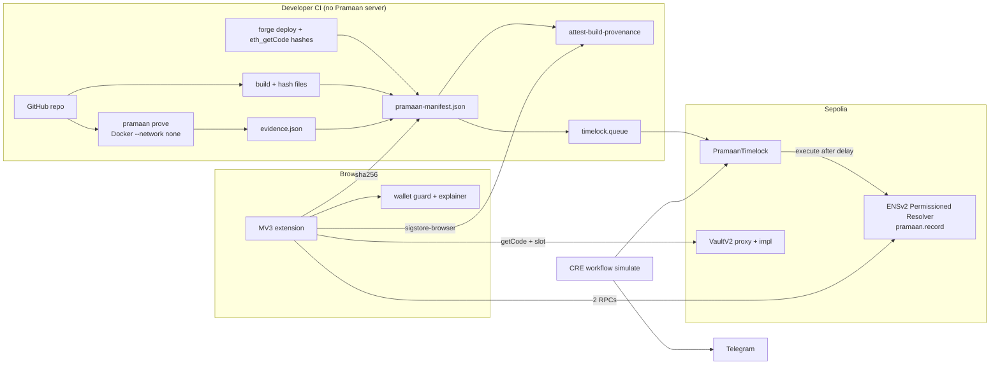
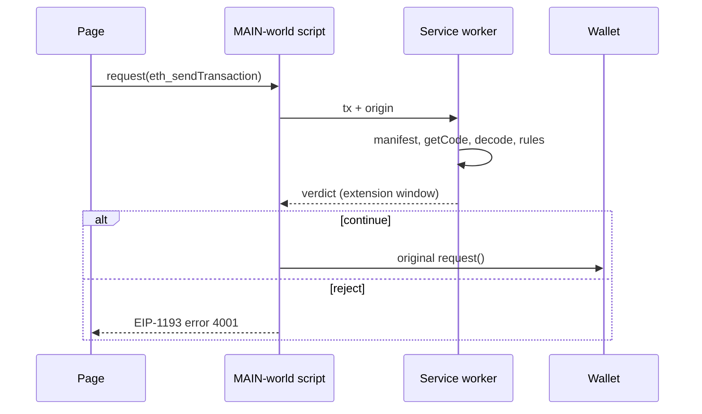

# PRAMAAN: Verified Research, Redesign and Build Plan for ETHGlobal Mumbai 2026

Pramaan is worth building, but as a smaller and more honest product than the original proposal. The core is one trust chain you can demonstrate end to end: a GitHub-attested release manifest, pointed to by an ENSv2 text record that only a timelock can write, and verified in a browser extension before the user signs. Everything else is a supporting module. Present the "AI exploit agent" as a template-driven proof harness, not as a general auditor.

## TL;DR

- **Verdict:** this is a strong, differentiated submission for ENS "Best Use of ENSv2" ($7,000) and the Ethereum Foundation CROPS / Anon-RPC tracks. The EF's own example idea is "a tool that proves the shipped frontend or extension matches the public repo."\[1\] It is only credible if the whole slice is real: a Foundry-reproduced bug → a signed manifest → an ENSv2 timelocked pointer → the extension turns red on a tampered file or an unlisted contract → a deterministic Hindi/English explanation of an unlimited approval. Chainlink CRE ($1,500, simulation accepted) is an optional third pick.\[2\] Uniswap, 0G, World, Hedera, Arkiv, Arc, Whitechain, 1inch and Definitive do not fit without artificial integrations.
- **Biggest corrections to your notes:**
  - ENSv2 is now live on Ethereum mainnet (since 27 Oct 2026), and the ENS track accepts mainnet or Sepolia.\[1\]\[3\]\[4\]
  - EF CROPS criteria are fully published, not "tbc".\[1\]
  - The 0G track is "Build with 0G PC"; iAI is only a bonus.\[1\]
  - The PoPETs figure is 23.0M users (65.4%) affected, not 35M.\[5\]\[6\]
  - No storage, wallet or security sponsor is present at Mumbai.\[1\]
  - ETHGlobal's rules say AI should "assist… not create the entire project".\[7\]
- **Build:** solo, 36 hours, no backend server. Five deliverables:
  1. Foundry contracts: a vulnerable vault, a fixed vault, and a minimal `PramaanTimelock`.
  2. A `pramaan` CLI that runs Slither plus template exploit tests inside network-less Docker.
  3. A GitHub Action that builds the site, hashes it and attests the manifest.
  4. An MV3 extension that verifies the ENS pointer → manifest hash → Sigstore identity → site files → contract code hashes → decoded transaction.
  5. README, CROPS section and video.

  A team of 3–4 adds a leak guard, Anon-RPC routing of the extension's own reads, a CRE monitor, and Marathi.

---

## Deliverable 1 — Executive verdict

**Strong project?** Yes, conditionally.

**Strongest differentiator:** ENSv2's role model fits Pramaan almost exactly. The Permissioned Resolver docs show `grantSetterRoles(setter, account)` granting a role for a single text key: ENS's example delegates "avatar", and writing any other key reverts with `EACUnauthorizedAccountRoles`.\[8\] That means a timelock contract can change one record key (`pramaan.record`) and nothing else. The trust root is independent of the website: GitHub's OIDC identity in Sigstore, plus an ENS key that only a timelock can write and that gives a delayed, alertable window before any change takes effect. That is "ENSv2 central, not cosmetic" in the literal sense the judges ask for.

**Biggest weaknesses (a skeptical reviewer's view):**

1. **Prior art.** Sourcify already ships "onay", a local signing companion that uses its clear-signing library with ERC-8176 trusted auditors.\[9\] Freedom of the Press Foundation's WEBCAT verifies web apps against Sigstore-signed manifests using `@freedomofpress/sigstore-browser`.\[10\]\[11\] Pramaan's novelty is the combination, not any single part.
2. **A compromised domain can point `/.well-known/pramaan` at an attacker-owned ENS name.** Mitigations:
   - pin the origin to its first-seen ENS name (TOFU);
   - require the owner-only `pramaan.domain` record to equal the origin;
   - check `pramaan.repo`.
   These mitigate but do not guarantee.
3. **Chrome MV3 cannot read response bodies.** Site verification re-fetches files and compares hashes. That catches mass CDN/S3 swaps but not targeted cloaking.
4. **A provider wrapper is advisory, not enforcement.** A malicious page can bypass it; the real enforcement point is the wallet.
5. **"AI exploit generation" is the least reliable part.** Use templates and say so on stage.
6. **Hacken's data undercuts a "code bugs" pitch.** Hacken's 2025 Yearly Security Report puts total losses at $4.0B. Smart-contract vulnerabilities were $512M (12.8%), access control $2.12B (53%) and phishing/social engineering $952M (23.8%): "76.8% of 2025 losses came from operational failures, not from bugs in the code." Lead with release integrity and signing (Bybit-style).

---

## Deliverable 2 — Claim verification

### 2a. Statistics and incidents in the proposal

| Claim | Status | Primary-source finding / correction |
|---|---|---|
| 98% of 1,072 vibe-coded Supabase apps had ≥1 flaw, 16% critical (Symbiotic, Jun 2026) | **VERIFIED, caveated** | Symbiotic blog (2 Jun 2026): 1,046/1,072 (98%) ≥1 vulnerability; 173 (16%) critical; 313 (29%) critical or high; 26 clean. Vendor research on Supabase web backends (RLS, unauthenticated DELETE/PATCH), not on smart contracts.\[12\]\[13\] |
| Moonwell lost $1.78M; AI-co-written oracle priced cbETH at $1.12 vs ~$2,200 | **VERIFIED, reword** | Moonwell post-mortem (via Cointelegraph, Protos, Rekt): MIP-X43 (15 Feb 2026) used only the cbETH/ETH rate; 1,096.317 cbETH liquidated; ~$1.78M bad debt. PR 578 had commits "co-authored by Claude Opus 4.6".\[14\]\[15\]\[16\] That AI *caused* it is contested, since humans reviewed and executed it. Only a price-sanity invariant would have caught it. |
| $512M smart-contract bug losses in 2025 (Hacken) | **VERIFIED** | Hacken 2025 Yearly Security Report: $512M (12.8%) of $4.0B (Cointelegraph: ~$3.95B). Access control $2.12B (53%); phishing/social engineering $952M (23.8%); "76.8% of 2025 losses came from operational failures, not from bugs in the code." |
| Bybit >$1.5B (Feb 2025), Safe{Wallet} S3 JS swapped, contracts fine | **PARTLY VERIFIED (forensics not re-fetched)** | Matches widely reported Sygnia/Verichains forensics: malicious JS changed a transaction so signers approved a `delegatecall` that replaced the Safe masterCopy (slot 0). Amount: the FBI's PSA of 26 Feb 2025 attributes "approximately $1.5 billion" to North Korea ("TraderTraitor"), stolen on or about 21 Feb 2025; TechCrunch reports 401,346 ETH, "around $1.4 billion at the time." The decisive failure was blind-signing an `operation = 1` Safe transaction, so the decoder must flag that. Re-check the forensic reports before quoting them. |
| $83.85M, 106,106 victims; Permit = 38% of >$1M losses (Scam Sniffer) | **VERIFIED** | Scam Sniffer 2025: $83.85M, 106,106 victims (−83% / −68% vs $494M / 332K in 2024). Permit/Permit2 were 38% of large-case losses; 11 cases >$1M; largest $6.5M (September); malicious EIP-7702 signatures appeared after Pectra. Covers EVM wallet-drainer phishing only.\[17\]\[18\]\[19\] |
| ~10.6% of Indians speak English (Census 2011) | **VERIFIED; reword** | Census of India 2011: 129M total English speakers = 10.6%. Only 259,678 (0.02%) speak it as a first language, ~83M as a second and ~46M as a third. Say "~10.6% reported speaking English at all". The data is 15 years old. |
| India leads crypto adoption (Chainalysis 2025) | **VERIFIED** | Chainalysis, "The 2025 Global Adoption Index" (2 Sep 2025, 151 countries): "India ranks first… followed closely by the United States, Pakistan, Vietnam, and Brazil." This is India's third straight year at #1, and it ranked first in all four sub-indices. |
| 211 of 616 dapps leak addresses (USENIX Sec 2023) | **VERIFIED** | Ferreira Torres, Willi & Shinde (ETH Zurich), USENIX Security '23, pp. 769–786: "We intercept the traffic of 616 decentralized applications and 100 wallets and find over 2000 leaks across 211 applications and more than 300 leaks across 13 wallets." That is 35% of connected dApps, leaking to 137 unique third parties. |
| Wallet extensions with 35M users link addresses via RPC (PoPETs 2026) | **PARTLY VERIFIED: overstated** | PoPETs 2026(3):523–537, DOI 10.56553/popets-2026-0094 (KU Leuven): 85 wallets *representing* 35.16M users; **17 wallets leak linkability, affecting 23.0M users (65.4%)**. Many wallets also inject providers into cross-origin iframes.\[5\]\[20\] |

### 2b. Prior-session notes

| Note | Status |
|---|---|
| ENS Best Use of ENSv2 $7,000 (3k/2k/1k/1k); central; no hard-coded values; live demo; open source; AI-agent bonus | **VERIFIED.** Network: "Ethereum mainnet or Sepolia". The $3,000 "Existing Project" prize is Continuity-only, so you are not eligible.\[1\] |
| EF Best CROPS App $3,500 (1st $2,000), criteria "tbc" | **Amount VERIFIED (2nd $1,000, 3rd $500); "tbc" FALSE.** Five published requirements (Deliverable 5). Example ideas are verbatim, including "a tool that shows what an app leaks (RPC calls, trackers, metadata)".\[1\] |
| EF Best Use of Anon-RPC $5,000; at most one EF track | **VERIFIED** (2.5k/1.5k/1k). "Your app routes its RPC reads through Anon-RPC by default."\[1\] |
| Chainlink CRE $1,500 (2 × $750); simulation OK? | **$1,500 VERIFIED; the split is not shown. Simulation VERIFIED:** "It is NOT mandatory to deploy… simulation is enough!"\[2\] |
| Uniswap $10,000 (1st $4k), FEEDBACK.md | **VERIFIED**, plus the Uniswap Developer Feedback Form.\[1\] |
| 0G "Build with iAI" $5,000 | **PARTLY:** the track is "Build with 0G PC" and iAI is a bonus. "Not wanted: apps where the AI call could be removed without anyone noticing."\[1\] |
| World ~$12.5k; Hedera x402 $6,500; Arkiv; Whitechain | **VERIFIED** (Arkiv's Mirror track excludes Sourcify data).\[1\] |
| `grantSetterRoles` scoped to text keys | **VERIFIED** (Deliverable 4).\[8\] |
| Mintable test USDC; Sepolia resets; last redeploy 1 Oct 2026 | **VERIFIED**, but two ENS doc pages give conflicting token addresses.\[21\]\[22\]\[23\] |
| viem ≥ 2.35 | **VERIFIED** (ENS readiness: viem ≥ 2.35.0; ENSjs ≥ 4.2.3 reads, ≥ 5.2.5 v2 writes).\[22\] |
| `@ethereum-sourcify/clear-signing` `format()` / `formatTypedData()` | **VERIFIED** (npm 0.3.x; browsers; only runtime dependency `@noble/hashes`).\[24\]\[25\] |
| ERC-8176 reviewer attestations | **PARTLY:** the library implements ERC-8176 with an EAS revocation check on mainnet; ERC text not read.\[26\] |
| EF Clear Signing blog (12 May 2026) | **NOT VERIFIED.** The launch is confirmed by Sourcify's blog: "an open standard (ERC-7730), a neutral registry, an attestation framework, and developer libraries."\[27\] |
| Anon-RPC 0.3, Nox only on Sepolia, `@anon-rpc/browser-extension-harness` | **Package VERIFIED** (EF prize page; Ambire PR bumps it to 0.3.3).\[1\]\[28\] **"Nox only Sepolia" NOT VERIFIED.** The guide says anonymizing networks "live on mainnet today" (Tor, Nym, Nox).\[28\]\[29\] |
| CRE 250 KB response, 15 HTTP calls; no `node:crypto` | **Limits VERIFIED; `node:crypto` NOT VERIFIED.**\[30\] Use `@noble/hashes`. |
| sigstore-browser | **VERIFIED** (`@freedomofpress/sigstore-browser`).\[31\] |
| WEBCAT EF grant Aug 2026; Verifiable Web (HackMoney 2026) | **NOT VERIFIED.** |

### 2c. Event facts

- **Official prizes page, 12 partners:**
  - World $12,500, 1inch $7,000, 0G $15,000, Uniswap $15,000, Arc $15,000, Hedera $15,000, Arkiv $15,000, Whitechain $15,000, EF $15,000, ENS $10,000, Definitive $5,000, Chainlink $5,000.\[1\]
  - Finalists: solo 250 USDC with no travel; 3–5 people 1,000 USDC + 500 USDC travel per person.\[1\]
  - ETHGlobal on X: "$175,000+ in prizes. 12 partners."\[32\]
- **Absent:** Filecoin/IPFS/Pinata/Storacha, MetaMask, Coinbase/Base, Ledger, and security firms. Swarm appears only as an Arkiv bonus.\[1\] IPFS therefore earns nothing and stays optional.
- **Rules:**
  - Up to 3 partner prizes; a partner's multiple tracks count as one.\[7\]
  - Classic: "all work… must begin after the hackathon officially starts. Any prior project-specific code, designs, or assets are not allowed."\[7\]
  - "AI tools should be used to assist… not to create the entire project."\[7\]
  - Keep this report as research notes, write all code after kickoff, and keep `AI_USAGE.md`.
- **Date conflict:** third-party listings say 6–8 Nov with submissions on Sun 8 Nov.\[33\]\[34\] The official prizes page schedules workshops on Thu 5 Nov,\[1\] which matches your dashboard (5 Nov 21:00 → 7 Nov 09:00).\[1\] Trust the dashboard and confirm at check-in.

---

## Deliverable 3 — Feature feasibility matrix

| Feature | Feasible | Security value | Complexity | Demo | Decision |
|---|---|---|---|---|---|
| Slither candidates | Yes | Low (heuristic) | Low | Local | **P0**, labelled "candidate" |
| Template Foundry exploit, prove → fix → re-prove | Yes | High (for that class) | Medium | Local/fork | **P0** |
| LLM-generated exploit tests | Partly | Variable; false proofs | High | Local | **P2** behind gates |
| Fix PR | Yes | Medium | Medium | GitHub | **P1**, human merges |
| Manifest + GitHub Artifact Attestation | Yes | High | Medium | GitHub | **P0** |
| ENSv2 key-scoped role held by timelock | Yes | High | Medium | Sepolia | **P0** (primary sponsor) |
| Custom on-chain registry | Yes | Same as ENS | Low | Sepolia | **Drop** |
| IPFS pinning | Yes | Availability only | Medium | Gateway | **P2** |
| Site-file verification | Yes, limited | High vs mass swap | Medium | Demo site | **P0** |
| Code-hash + proxy implementation check | Yes | High | Low–Medium | Sepolia | **P0** |
| Sourcify match status | Yes | Medium | Low | Sepolia | **P1** |
| Deterministic decoding + risk rules | Yes | High | Medium | Sepolia | **P0** |
| ERC-7730 rendering | Yes | High | Medium | Sepolia | **P1** |
| Hindi + English (Marathi P1) | Yes | High | Low | Yes | **P0** |
| Leak detection on a controlled page | Yes | Medium | Medium | Demo | **P1** |
| Leak blocking (DNR) | Yes | Medium | Low–Medium | Demo | **P2** |
| Anon-RPC for the extension's reads | Yes | Medium–High | Medium | Live | **P1 team / P2 solo** |
| "Private mode" for the page's reads | Weak | Low (page and wallet still see the address) | High | — | **Remove** |
| CRE monitor (simulated) → Telegram | Yes | Medium | Medium | CLI | **P1** |
| MetaMask Snap insight | Unverified | Highest | High | Flask | **P3** |
| GitHub App + hosted backend | Yes | — | High | — | **P3** |

---

## Deliverable 4 — Technology comparison and verified facts

### 4a. ENSv2 (primary)

**Live status.** Sepolia, and mainnet since 27 Oct 2026 (ENS Labs announcement, reported by crypto.news and ChainCatcher).\[4\]\[35\] The Sepolia Explorer warns that names "may be reset periodically… The most recent deployment was on October 1, 2026."\[21\]

**Sepolia addresses** (docs.ens.domains/learn/deployments):
- Universal Resolver proxy `0xeEeEEEeE14D718C2B47D9923Deab1335E144EeEe` (same on mainnet; "Do not hardcode", so let viem choose)\[23\]\[36\]
- ETHRegistrar `0xf633e7fc17e2bbe0d0965d18ec1821dcb754a3d3`\[36\]
- ETHRegistry `0xd4ebcbbdf463c9c45784603db0ddd499bc44a8b4`\[36\]
- VerifiableFactory `0xda70306c98e97ece36f997a21368e53298572991`\[36\]
- PermissionedResolverImpl `0x115eb53f0c60696633855f90b138178fb40b2b2c`\[36\]
- MockUSDC `0x240b0316df57887dbbe58b586508b19e633a14aa`\[36\]

**Conflict:** the readiness page links a different test USDC (`0x16f95d91…`).\[22\] Check it with `isPaymentToken` on the price oracle.

**Registration** is commit-reveal: `makeCommitment` → `commit` → wait ≥60 s → `register(label, owner, secret, subregistry, resolver, duration, paymentToken, referrer)`.\[37\] Payment is in an approved ERC-20; Sepolia MockUSDC's `mint` "has no access control".\[23\] Registering by hand in the ENS app is not project code.

**Resolver setup:**
- Deploy a per-account UUPS proxy with `VerifiableFactory.deployProxy(PermissionedResolverImpl, salt, initialize(grants, calls))`.\[38\]
- Point the name at it with `setResolver(tokenId, resolver)` on the ETHRegistry. This needs `ROLE_SET_RESOLVER`, which the registrant receives.\[37\]\[39\]
- Setters take DNS-encoded names: `setText(bytes name, string key, string value)`.\[8\]

**Roles:**
- `ROLE_SET_TEXT = 1<<4`, `ROLE_LINK = 1<<28`, `ROLE_UPGRADE = 1<<124`; each role's admin is `role<<128`.\[8\]
- For `grantSetterRoles`, "The caller must hold the corresponding admin role."\[8\]
- `grantRoles()` always reverts on the resolver.\[8\]
- Revoke a key-scoped role with `revokeRoles(keccak256(key), ROLE_SET_TEXT, account)`.\[8\]

**Trust caveats:**
1. "There is no per-name scoping… every name served by the resolver instance." The app's name needs a dedicated owner account and its own resolver.\[8\]
2. Freezing a setter does not freeze what a name serves. A `ROLE_LINK` holder can relink records, a `ROLE_UPGRADE` holder can swap the implementation, and the registry's `ROLE_SET_RESOLVER` holder can repoint the name.\[8\] Monitor `TextUpdated`, `Linked`, the resolver's ERC-1967 `Upgraded`, and registry resolver changes.

**Timelock as role holder.** The docs grant roles to `account` addresses and show contracts (the registrar) holding roles, but never mention timelocks.\[37\] A timelock holding a key-scoped role is a strong inference; test it on Sepolia in hour 1.

**Library support.** Old clients may return `null`. ENSv1 names keep resolving via a mirror resolver.\[23\]

**Why ENS over a custom registry:** the same guarantees plus identity, explorer, indexers and the prize.

### 4b. Release provenance

**Choice:** `actions/attest-build-provenance` produces a Sigstore DSSE + in-toto SLSA bundle with subject `pramaan-manifest.json`.

**Browser verifier:** `@freedomofpress/sigstore-browser` (`SigstoreVerifier`, `loadSigstoreRootWithTUF()`, Web Crypto, bundle v0.1–0.3).\[31\]
- Pin the latest release. A Sep 2026 audit PR fixed real bypasses: padding a bundle with unverified tlog entries "satisfied any threshold", and the logged certificate was not compared.\[40\]
- The Oct 2026 crypto-browser 0.2 release switched Rekor SET checks to RFC 8785 JCS.\[41\]
- WEBCAT's own CLI replaced `tuf-js` with it.\[10\]
- Avoid Node-oriented `sigstore-js` in MV3.

**Identity policy:**
- issuer `https://token.actions.githubusercontent.com`
- SAN `https://github.com/<org>/<repo>/.github/workflows/release.yml@refs/tags/<tag>`
- provenance commit = `manifest.commit`

**Not verified (check on day 1):**
- the attestations REST route (believed `GET /repos/{owner}/{repo}/attestations/{subject_digest}`);
- unauthenticated access for public repos;
- private repos using GitHub's own Sigstore instance.

Upload the bundle as a release asset too, and **use a public repo.**

**What it proves:** "workflow W in repo R at commit C produced this manifest." Not that the code is secure.

### 4c. Contract verification

**Compare deployed code to deployed code.** CI records `keccak256(eth_getCode)` after deployment. That hash already includes immutables, linked libraries and CBOR metadata, so none of them cause false mismatches. Sourcify answers a different question: does the source match the bytecode? "Exact" also matches the metadata hash; "match/partial" matches only executable code. APIv2 routes are not re-verified.

**Proxy detection order:**
1. EIP-7702: code starts with `0xef0100`.
2. EIP-1167: `363d3d373d3d3d363d73…5af43d82803e903d91602b57fd5bf3`.
3. EIP-1967 implementation slot `0x360894a13ba1a3210667c828492db98dca3e2076cc3735a920a3ca505d382bbc`.
4. EIP-1967 beacon slot `0xa3f0ad74e5423aebfd80d3ef4346578335a9a72aeaee59ff6cb3582b35133d50` → `implementation()`.
5. EIP-1822 slot `0xc5f16f0fcc639fa48a6947836d9850f504798523bf8c9a3a87d5876cf622bcf7`.
6. Safe `masterCopy` at slot 0 (the Bybit target).
7. EIP-2535 diamond: "cannot verify" in the MVP.

### 4d. Transaction explanation

**Library:** `@ethereum-sourcify/clear-signing` (ERC-7730 reference implementation; registry `ethereum/clear-signing-erc7730-registry`).\[26\]\[42\] The public registry has no descriptors for your Sepolia demo contracts, so ship a Pramaan-authored descriptor *in the signed manifest* via the `DescriptorResolver` hook.

**Deterministic risk rules always apply:**
- `approve` ≥ 2^255 or Permit2 max
- `setApprovalForAll(true)`
- Permit/Permit2 typed data
- Safe `execTransaction` with `operation == 1`
- EIP-7702 authorization
- unknown selector or unparsed multicall → "cannot confidently interpret"

**Simulation** (`eth_simulateV1`, viem `simulateCalls`, Tenderly/Alchemy) was **not verified** for Sepolia support. It is P2 and never required for a verdict.

### 4e. Monitoring

**CRE facts (verified):**
- `cre workflow simulate` "makes real calls to configured RPCs and HTTP endpoints".\[43\]
- Writes are dry-run unless `--broadcast` is set, which sends real testnet transactions from a funded `CRE_ETH_PRIVATE_KEY`.\[44\]\[45\]
- Quotas: 15 HTTP calls per execution, 250 KB response, 120 KB request, 100 KB returned, 5 KB per log event. `cre workflow limits export` shows them.\[30\]\[46\]

A viem `watchContractEvent` worker is simpler. CRE's advantage here is the decentralized-execution narrative and the prize.

**Not verified:** the TS SDK package name and version, deploy access, and consensus behaviour on POSTs. Put an idempotency key (`queueId`) in each alert and dedupe in the bot.

### 4f. Security tooling

- **Slither** (JSON) for candidates.
- **Foundry** for proofs (`vm.expectRevert` on the fixed contract) and invariants for oracle maths.
- **Aderyn** optional.
- **Echidna/Medusa/Halmos** P3; skip **Mythril**.
- Versions were not re-checked: pin what `foundryup` and `pip install slither-analyzer` install on day 1, and record them in `tools[]`.
- I found no verified peer-reviewed measurement of LLM exploit-test reliability. The "$4.6M simulated exploits" claim is second-hand, so don't cite it.

---

## Deliverable 5 — Sponsor selection

| Track | Amount | Fit | Qualifying integration | Decision |
|---|---|---|---|---|
| **ENS — Best Use of ENSv2** | $7,000 | Excellent | Dedicated Permissioned Resolver; `grantSetterRoles(setText(_, "pramaan.record", _), timelock)`; queue/execute; viem reads; demo of a reverting unauthorized write; live demo link; open source | **Primary** |
| **EF — Best CROPS App** (or Anon-RPC; placed in ≤1) | $3,500 / $5,000 | Excellent ("S" lead) | MIT repo; README section "CROPS" with C/O/P/S lines; ≤3-min video showing the moment it matters (backend off and the site still verifies from cache + ENS; tampered JS goes red); no trackers. For Anon-RPC: extension reads routed by default\[1\] | **Secondary** |
| **Chainlink — CRE** | $1,500 | Good | Workflow reads timelock queue + ENS record + EIP-1967 slot, fetches the manifest, compares hashes, POSTs to Telegram; CLI simulation log | **Optional third** (cut first) |
| Uniswap | $10,000 | Weak | Only via v4-hook exploit templates + FEEDBACK.md | Team stretch |
| 0G, World, Hedera, Arc, Arkiv, Whitechain, 1inch, Definitive | — | Artificial | — | Skip |

---

## Deliverable 6 — Final architecture

### 6.1 Product definition

Pramaan is an open-source release-integrity and signing-safety system for Ethereum dApps.

**For developers:** a CLI and a GitHub Action that:
- reproduce specific bug classes with Foundry tests ("no proof, no finding");
- emit a manifest of exact frontend file hashes, deployed contract code hashes (including proxy implementations) and evidence hashes;
- attest it with GitHub's Sigstore identity;
- publish its hash into the project's ENSv2 name through a timelock that can write only that record.

**For users:** an extension that independently fetches the pointer, manifest and attestation, checks the site files and the target contract, and explains each transaction deterministically in Hindi, Marathi or English. It never says "safe"; it lists what was checked and what could not be.

### 6.2 User journeys

**Developer:**
1. `pramaan prove` runs in Docker with no network: Slither candidates → template test → evidence.json.
2. Fix.
3. Re-run: the exploit must revert and `forge test` must pass.
4. Tag. The Action builds, hashes, writes the manifest, attests, uploads assets, and calls `timelock.queue("pramaan:v1:<tag>:<sha256>")`.
5. After the delay, anyone calls `execute`.

**User:**
1. Visit the site. The extension reads the `/.well-known/pramaan.json` hint → checks `pramaan.domain` == origin → checks the TOFU pin → reads `pramaan.record` → fetches the manifest and bundle → verifies the hash and identity → compares scripts.
2. Badge shows green, amber or red.
3. On `eth_sendTransaction` / `eth_signTypedData_v4`, the wrapper pauses and the extension window shows Contract / Action (Hindi/English) / Privacy.
4. Reject, or continue to the wallet.

### 6.3 Diagrams





### 6.4 Data architecture

**MVP: files only.**

`pramaan-manifest.json` v1:
- `schema`, `app{name,ensName,domain}`, `repo`, `commit`, `tag`, `workflow`, `builtAt`
- `files[{path,sha256,sri}]`
- `contracts[{label,chainId,address,runtimeCodehash,proxy{type,implAddress,implCodehash}|null,sourcify{status}}]`
- `findings[{id,class,severity,status,exploitTestSha256,evidenceSha256,fixCommit}]`
- `descriptors[{address,erc7730Sha256,path}]`
- `thirdParties[{host,purpose,receivesAddress}]`
- `tools[{name,version}]`

`evidence.json`:
- `findingId`, `candidateSource{tool,detector,location}`, `preconditions`, `testPath`, `testSha256`
- `vulnerableRun{result,traceExcerpt}`, `fixedRun{result,revertReason}`, `regressionSuite{passed,failed}`
- `confidence` ("reproduced" | "not-reproduced"), `humanReviewed`

**Production (P3) Postgres tables:**
- `projects(ens_name, repo, domain)`
- `releases(tag, commit, manifest_sha256, pointer_tx, status queued|active|superseded|revoked)`
- `artifacts`, `contracts(codehash, impl_codehash, sourcify_status)`
- `analysis_jobs(idempotency_key UNIQUE(project, commit, toolchain_hash))`
- `findings`, `exploit_tests`, `fix_proposals`
- `monitor_events(UNIQUE tx_hash, log_index)`
- `alerts(UNIQUE idempotency_key)`

Cache analysis by `(codehash, toolchain_hash)`.

### 6.5 API

**MVP: none.** The extension talks only to RPCs, GitHub release assets and the Sigstore TUF mirror.

**Production:** `POST /v1/jobs`, `GET /v1/jobs/{id}`, an HMAC-verified `POST /v1/github/webhook`, and a convenience mirror `GET /v1/releases/{ens}/{tag}` that the extension never depends on.

### 6.6 Contracts (Solidity ^0.8.24, Foundry, non-upgradeable)

**`PramaanTimelock`:**
- Immutables: `resolver`, `dnsName`, `delay`. Constant key `"pramaan.record"`. Roles: `proposer` (CI) and `guardian` (owner, a Safe in production).
- `queue(value)` → emits `Queued(id, value, eta)`.
- `execute(id)` can be called by anyone after `eta`; it calls `setText` and emits `Executed`.
- `cancel(id)` and `setProposer` are guardian-only.
- No arbitrary calls, and the key is fixed.

**`VulnerableVault` / `VaultV2`:** `withdrawAll()` is missing `onlyOwner`, and the fix adds it. V2 sits behind an OpenZeppelin `ERC1967Proxy`.

**Authority split:**
- The owner holds the name, all resolver roles and admins, `pramaan.repo` and `pramaan.domain`.
- The timelock holds only `ROLE_SET_TEXT` on `keccak256("pramaan.record")`.
- A stolen CI key can only queue a visible, cancellable pointer change.

### 6.7 Trust model

| Component | Trusted for | Not trusted for |
|---|---|---|
| GitHub OIDC + Sigstore | which workflow/repo/commit produced the manifest | code quality, workflow honesty |
| ENS owner / Safe | choosing repo, domain, timelock | (compromise is total) |
| Timelock delay | making changes visible | stopping unwatched changes |
| Hosting/CDN/IPFS | availability | integrity |
| RPCs | data (two must agree) | privacy |
| Extension | running the listed checks | proving no leaks or bugs |
| AI agent | drafting tests and fixes | deciding findings or risk |

---

## Deliverable 7 — Threat model (STRIDE)

| # | Threat | STRIDE | Prevention / detection | Residual | MVP |
|---|---|---|---|---|---|
| 1 | Malicious developer signs a bad release | T | Evidence lists only what was proven | High | Stated |
| 2 | Compromised GitHub account | S | Timelock + alert + cancel; tag protection | Medium | Yes |
| 3 | Stolen CI key | E | Key-scoped role; delay; cannot touch other records | Low–Medium | Yes (revert demo) |
| 4 | Malicious dependency | T | Lockfiles, `npm ci`; provenance shows commit | High | Partial |
| 5 | CDN/S3 tampering | T | Re-fetch + sha256; unlisted script → red | Cloaking | **Yes** |
| 6 | ENS record change | T | Timelock-only key; watch Text/Linked/Upgraded/resolver | Owner key | Yes |
| 7 | Malicious proxy upgrade | T | Implementation-slot check per tx; `Upgraded` monitor | Low | Yes |
| 8 | Fake record / lookalike domain | S | `pramaan.domain` match; TOFU; repo identity | First visit | Yes |
| 9 | Prompt injection into agent | T | The outcome is a mechanical test on vulnerable + fixed code; human merges | Medium | Yes |
| 10 | RPC observes queries | I | Anon-RPC for extension reads | Wallet's own RPC | Team |
| 11 | Analytics exfiltration | I | Body/URL scan vs `thirdParties[]` | Obfuscation, WebSockets | P1 |
| 13 | Malicious repo | E | Docker `--network none`, read-only, non-root, limits, timeout, tmpfs | Escape (gVisor later) | Yes |
| 14 | Command injection | E | `execFile` allowlist, no shell, no secrets mounted | Low | Yes |
| 15 | Malicious extension update | T | Open source, pinned deps, build hash in own manifest | Store updates | Stated |
| 16 | Page bypasses wrapper | E | Disclose; wallet/Snap integration later | **High** | Stated |

(#12, the backend, does not apply: the MVP has no backend.)

**Gates before a generated test may be labelled "proven":**
1. It passes on the vulnerable code and reverts as expected on the fixed code.
2. It asserts a concrete state change (attacker balance or owner).
3. It uses no owner `vm.prank` and no `vm.store`/`deal` on the target.
4. A human has reviewed it.

A failing test means "not reproduced", not "absent".

---

## Deliverable 8 — MVP scope

**P0 (solo):**
1. Contracts and tests deployed to Sepolia.
2. `pramaan prove` with evidence.json and a re-run on the fix.
3. Release Action → manifest → attestation → `queue`.
4. ENSv2 setup scripts + negative-write test.
5. Extension: pointer (2 RPCs), manifest hash, Sigstore identity, site check, contract check, decoder + Hindi/English, wrapper with reject.
6. Demo dApp with tamper and unlisted-contract switches.
7. README + CROPS + AI_USAGE.md + video.

**P1:** CRE simulation → Telegram; leak detector; Marathi; Sourcify status; ERC-7730 rendering; Anon-RPC reads.

**P2:** LLM tests behind gates; DNR blocking; IPFS; simulation.

**P3:** GitHub App/backend; Snap; diamonds; Firefox strict mode.

**Cut order:** CRE → Marathi → leak guard → Sourcify → descriptor.

**Never cut:** prove → fix → re-prove; tamper → red → blocked; the timelocked ENSv2 record.

---

## Deliverable 9 — Deployment and demo plan

**To do:**
- Install Node 22, pnpm, Docker, Foundry, Python 3.11 + `slither-analyzer`, Chrome, the CRE CLI.
- Accounts: GitHub (create the repo), two Sepolia RPCs, Telegram bot, CRE account.
- Fund two fresh Sepolia-only wallets (owner, proposer). **Never use real funds or paste seed phrases.**

**`.env`:** `SEPOLIA_RPC_URL_A`, `SEPOLIA_RPC_URL_B`, `OWNER_PRIVATE_KEY`, `PROPOSER_PRIVATE_KEY` (also a GitHub secret), `ENS_NAME`, `TIMELOCK_DELAY_SECONDS=300`, `TELEGRAM_BOT_TOKEN`, `TELEGRAM_CHAT_ID`, `CRE_ETH_PRIVATE_KEY` (only with `--broadcast`).

**Sequence:**
1. `forge test`
2. `pramaan prove` against `anvil` or `anvil --fork-url $SEPOLIA_RPC_URL_A`
3. Register the name in the Sepolia ENS app (mint MockUSDC, approve, commit, register)\[23\]\[37\]
4. `forge script script/Deploy.s.sol --rpc-url $SEPOLIA_RPC_URL_A --broadcast`
5. `pnpm ens:setup`
6. `forge verify-contract --verifier sourcify` (check flags)
7. Push tag `v1.0.0`
8. After the delay: `pnpm ens:execute`
9. Host the genuine build (GitHub Pages/Vercel) and a tampered copy on another origin
10. Load the unpacked extension
11. Demo:
    1. prove/fix log
    2. green site → Hindi unlimited-approval warning → reject
    3. tampered JS → red, blocked
    4. unlisted contract → amber
    5. CI-key `setAddress` revert on Etherscan
    6. queued change → CRE simulation → Telegram → guardian cancels

Record a fallback video of each step.

---

## Deliverable 10 — Roadmap

| Hours | Phase | Acceptance |
|---|---|---|
| 0–2 | Scaffold, pin toolchain | `pnpm -r build`, `forge test` green |
| 2–7 | Contracts, exploit, fix, timelock [Lane A] | Exploit passes on V1, reverts on V2 |
| 7–11 | Sepolia + ENS scripts [Lane B] | `getEnsText` works; unauthorized write reverts |
| 11–16 | Manifest + Action [Lane B] | `gh attestation verify` passes |
| 16–25 | Extension verification [Lane C] | Green / red (1 byte) / amber |
| 25–30 | Decoder + i18n + wrapper [Lane D] | S7–S8 pass |
| 30–33 | P1 (CRE or leak guard) | Log + Telegram |
| 33–36 | Docs, video, submit | Track checklists ticked |

Plan at least 4 hours of sleep around hour 20.

---

## Deliverable 11 — Repository specification

```
pramaan/
  contracts/            Foundry: src/{VulnerableVault,VaultV2,PramaanTimelock}.sol, test/, script/, exploits/templates/
  packages/manifest/    zod schema, generator, sha256/SRI, pointer codec
  packages/verifier-core/  ENS pointer, manifest + sigstore policy, proxy detection, codehash compare (fail closed)
  packages/decoder/     ABI/typed-data decoding, risk rules, en/hi/mr templates, clear-signing adapter
  apps/cli/             pramaan prove|manifest|publish (Docker, execFile allowlist)
  apps/extension/       MV3: service worker, MAIN-world wrapper, isolated relay, verdict window, offscreen (Anon-RPC)
  apps/demo-dapp/       Vite static site + tamper build; /.well-known/pramaan.json
  workflows/cre-monitor/  CRE workflow (P1)
  .github/workflows/    ci.yml, release.yml
  docs/                 THREAT_MODEL.md, AI_USAGE.md
```

The extension uses minimal host permissions, no remote code and no telemetry.

---

## Deliverable 12 — Claude Code implementation prompt (paste after 21:00 Thursday)

```
You are implementing PRAMAAN for ETHGlobal Mumbai 2026 (Classic, from scratch: all code is written now). I make design decisions and review every change; log notable AI help in docs/AI_USAGE.md. Commit small and often.

GROUND RULES
1. First inspect the repo and environment (ls, git status, node -v, forge --version, docker info, slither --version) and report before writing code.
2. Work phase by phase; after each phase run tests, fix failures, commit, and print exact commands.
3. No fake or hard-coded functionality. Anything unverifiable shows "unknown", never "verified". Label simulations.
4. Before using any external API, read its official docs and match exact names/ABIs; if docs contradict this prompt, stop and tell me. Docs: docs.ens.domains/ensv2/* and /learn/deployments; docs.chain.link/cre; github.com/freedomofpress/sigstore-browser; github.com/sourcifyeth/clear-signing; ethereum.github.io/anon-rpc; GitHub docs for actions/attest-build-provenance and the attestations API.
5. Never request, print or commit seed phrases/private keys; use .env (testnet-only), gitignored.
6. Stack: pnpm workspaces, TypeScript strict, Node 22, viem >= 2.35.0, zod, vitest; Foundry, Solidity ^0.8.24, OpenZeppelin; MV3 via Vite. Pin versions.

PHASE 1 contracts/: VulnerableVault (withdrawAll missing onlyOwner), VaultV2 (fixed) behind ERC1967Proxy with protected initializer. PramaanTimelock: immutable resolver, dnsName (DNS-encoded bytes), delay; constant KEY "pramaan.record"; proposer, guardian; queue(string) onlyProposer emits Queued(id,value,eta); execute(id) by anyone after eta calls resolver.setText(dnsName,KEY,value) emits Executed; cancel onlyGuardian; setProposer onlyGuardian; no arbitrary calls. Tests: exploit template (attacker balance delta == vault balance on V1; expectRevert on V2), timelock tests with mock resolver, withdraw fuzz test. script/Deploy.s.sol writes deployments/sepolia.json including keccak256 of on-chain runtime code for proxy and implementation.

PHASE 2 packages/manifest + apps/cli: manifest v1 zod schema exactly as: schema, app{name,ensName,domain}, repo, commit, tag, workflow, builtAt, files[{path,sha256,sri}], contracts[{label,chainId,address,runtimeCodehash,proxy{type,implAddress,implCodehash}|null,sourcify{status}}], findings[{id,class,severity,status,exploitTestSha256,evidenceSha256,fixCommit}], descriptors[{address,erc7730Sha256,path}], thirdParties[{host,purpose,receivesAddress}], tools[{name,version}]. Pointer "pramaan:v1:<tag>:<sha256 of manifest bytes>". `pramaan prove --repo --vulnerable <ref> --fixed <ref>` runs slither --json and the forge template in Docker (--network none --read-only --tmpfs /work --cpus 2 --memory 2g --pids-limit 256 --user 1000, 10-min timeout) via execFile argument arrays only; writes evidence.json; Slither output is "candidate"; confidence "reproduced" only if the test passes on vulnerable and reverts as expected on fixed. `pramaan manifest` and `pramaan publish` (timelock.queue with PROPOSER_PRIVATE_KEY).

PHASE 3 scripts/ens (viem): load Sepolia ENSv2 addresses from the deployments page into config and check code exists on-chain; deployResolver via VerifiableFactory.deployProxy(PermissionedResolverImpl, salt, initialize([{account: owner, roleBitmap: ALL_ROLES}], [])) parsing ProxyDeployed; setResolver on ETHRegistry; owner setText "pramaan.repo" and "pramaan.domain"; grantSetterRoles(encodeFunctionData(setText,['0x','pramaan.record','']), timelock); executePending; negativeTest where the proposer EOA's setText('url') and setAddress revert (record tx hash/revert for README). I register the name manually in the Sepolia ENS app; scripts only check ownership.

PHASE 4 .github/workflows/release.yml on tag v*: build demo-dapp, generate manifest, actions/attest-build-provenance with subject-path pramaan-manifest.json (permissions id-token: write, attestations: write, contents: write), upload manifest + bundle as release assets, run pramaan publish. Verify with gh attestation verify.

PHASE 5 extension + verifier-core + decoder:
- verifier-core: getEnsText from two RPCs (disagree => unknown); /.well-known hint only; require pramaan.domain == origin; TOFU pin origin->ENS name; fetch manifest from release asset; sha256 == pointer; verify bundle with sigstore-browser (loadSigstoreRootWithTUF) and policy: issuer https://token.actions.githubusercontent.com, SAN .../.github/workflows/release.yml@refs/tags/<tag> for pramaan.repo, DSSE subject digest == manifest sha256; cache verified manifests.
- Site check: webRequest.onCompleted (observe) + content-script DOM inventory incl. hashed inline scripts; re-fetch listed same-origin files (cache:'no-store'); unlisted/mismatched => RED; UI notes cloaking cannot be excluded on Chrome.
- Contract check: tx.to listed? keccak(getCode) == runtimeCodehash? detect 0xef0100, EIP-1167, EIP-1967 impl/beacon, Safe slot 0; compare implementation; diamonds => cannot verify.
- Wallet guard: MAIN-world script at document_start wraps window.ethereum.request and EIP-6963 announced providers for eth_sendTransaction, eth_signTypedData_v4, personal_sign, wallet_sendCalls; relay via isolated world to service worker; verdict in an extension window (chrome.windows.create), never page DOM; reject => EIP-1193 error 4001; continue => original provider; all else passes through. Document bypass risk.
- Decoder: ERC-20 approve/transfer/transferFrom, setApprovalForAll, EIP-2612 Permit, Permit2, Safe execTransaction (operation==1 => CRITICAL), EIP-7702; unknown => "Pramaan cannot confidently interpret this action". Rules set risk; en/hi templates (mr in P1), English one tap away. Optional @ethereum-sourcify/clear-signing format()/formatTypedData() with a DescriptorResolver serving the manifest descriptor only after its sha256 matches.

PHASE 6 (P1, only after P0 works): CRE TypeScript workflow (check docs for SDK/template) reading timelock queue + ENS record + EIP-1967 slot, fetching the queued manifest, hashing with @noble/hashes, POSTing Telegram with queue-id idempotency key, within 15 calls/250 KB; save `cre workflow simulate` log to docs/. Leak guard: webRequest.onBeforeRequest ["requestBody"] scanning for address (lower, checksum, no-0x, keccak256, sha256) and ENS name vs manifest.thirdParties; say "observed", never "no leaks". Anon-RPC: route verifier reads through @anon-rpc/browser-extension-harness in an offscreen document by default, with labelled fallback.

ACCEPTANCE: S1 exploit reproduces on V1; S2 reverts on V2, suite passes; S3 genuine release green with signer identity; S4 one-byte JS or manifest edit => red, signing blocked; S5 listed proxy/impl => green; S6 unlisted address or impl mismatch => amber/red; S7 transfer decoded; S8 unlimited approve and Safe delegatecall => high/critical in Hindi and English; S9 (P1) demo leak observed; S10 (P1) queued change => Telegram. Negative: wrong repo identity rejected; RPC disagreement => unknown; unknown bundle media type rejected; proposer cannot set other ENS keys.

DELIVERABLES: README (setup, architecture, commands, addresses, tx hashes incl. reverting unauthorized write, limitations), README section "CROPS" (C, O, P, S), MIT LICENSE, docs/THREAT_MODEL.md, docs/AI_USAGE.md. No trackers.
```

---

## Caveats

- **Not verified this session (search budget ran out):**
  - Chrome MV3 details (MAIN-world timing vs wallet injection, `requestBody` coverage), Integrity-Policy/signature-SRI status, and MetaMask Snaps allowlisting in 2026.
  - `eth_simulateV1` support, Sourcify APIv2 routes, the GitHub attestations REST route, tool versions, and the CRE TS SDK package/deploy access.
  - Bybit forensic details (the FBI-attributed ~$1.5B amount is now verified); WEBCAT's EF grant; Verifiable Web; and LLM-exploit reliability research.
  
  Each is labelled where it appears.
- **Sepolia ENS state can reset.**\[21\] Record tx hashes and video early.
- **Start Fresh rule:** ETHGlobal disallows prior "designs".\[7\] Treat this report as research notes, write all code after kickoff, and ask an organizer if unsure.

## Sources

1. [ETHGlobal](https://ethglobal.com/events/mumbai/prizes)
2. [ETHGlobal](https://ethglobal.com/events/mumbai/prizes/chainlink)
3. [ENSv2 Launches on Ethereum Mainnet with Enhanced Features](https://www.kucoin.com/news/flash/ensv2-launches-on-ethereum-mainnet-with-enhanced-features)
4. [ENSv2 officially launched on the Ethereum...](https://www.chaincatcher.com/en/article/2299348)
5. [The Masks We (Think We) Wear: Privacy Threats of Browser-Extension Wallets in the Web3 Ecosystem](https://arxiv.org/html/2607.06141v1)
6. [The Masks We (Think We) Wear: Privacy Threats of Browser-Extension Wallets in the Web3 Ecosystem · Pith](https://pith.science/paper/2607.06141)
7. [ETHGlobal Mumbai](https://ethglobal.com/events/mumbai/info/details)
8. [Permissioned Resolver](https://docs.ens.domains/ensv2/permissioned-resolver/)
9. [Clear signing (ERC-7730): the request in words, with trusted auditors by manuelwedler · Pull Request #30 · sourcifyeth/onay · GitHub](https://github.com/sourcifyeth/onay/pull/30)
10. [Refactor by lsd-cat · Pull Request #16 · freedomofpress/webcat-cli · GitHub](https://github.com/freedomofpress/webcat-cli/pull/16)
11. [GitHub - freedomofpress/webcat-cli: WEBCAT CLI tools for developers and website administrators · GitHub](https://github.com/freedomofpress/webcat-cli)
12. [We scanned 1072 vibe-coded apps: 98% had security flaws](https://www.symbioticsec.ai/blog/we-scanned-1-072-vibe-coded-apps-98-had-security-flaws)
13. [A 12-step security checklist for vibe-coded apps on Supabase (2026) - DEV Community](https://dev.to/patchandship/a-12-step-security-checklist-for-vibe-coded-apps-on-supabase-2026-2nl8)
14. [\$1.78M ‘Vibe-Coded’ Oracle Bug Puts AI-Coauthored Contracts Under Scrutiny](https://cointelegraph.com/news/moonwell-exploit-cbeth-oracle-misprice-ai-commits-testing-audits)
15. [DeFi, meet Claude: Moonwell's 'vibe-coded' oracle in \$1.8M blowup](https://protos.com/defi-meet-claude-moonwells-vibe-coded-oracle-in-1-8m-blowup/)
16. [Moonwell Suffers \$1.8M Loss After Oracle Glitch, With Claude Opus 4.6 Cited in Faulty Output - Crypto Economy](https://crypto-economy.com/moonwell-oracle-glitch-ai-linked-1-8m-loss/)
17. [Scam Sniffer 2025: Crypto Phishing Losses Fall 83% to \$84 Million - Scam Sniffer](https://drops.scamsniffer.io/scam-sniffer-2025-crypto-phishing-losses-fall-83-to-84-million/)
18. [2025 Crypto Phishing Losses Drop 83% to \$83.85M, Victims Fall 68%](https://www.kucoin.com/news/flash/2025-crypto-phishing-losses-drop-83-to-83-85m-victims-fall-68)
19. [Scam Sniffer: Crypto Phishing Losses Fall to \$83M in 2025 - CoinCentral](https://coincentral.com/scam-sniffer-crypto-phishing-losses-fall-to-83m-in-2025/)
20. [PoPETs Proceedings — The Masks We (Think We) Wear: Privacy Threats of Browser-Extension Wallets in the Web3 Ecosystem](https://petsymposium.org/popets/2026/popets-2026-0094.php)
21. [ENS Explorer App](https://sepolia.explorer.ens.domains/)
22. [Preparing for ENSv2](https://docs.ens.domains/web/ensv2-readiness/)
23. [For App Developers](https://docs.ens.domains/ensv2/tutorial-app-developers)
24. [@ethereum-sourcify/clear-signing - npm](https://www.npmjs.com/package/@ethereum-sourcify/clear-signing)
25. [GitHub - shukudaidayo/sourcifyeth-clear-signing: Sourcify Implementation of ERC-7730: Structured Data Clear Signing Format · GitHub](https://github.com/shukudaidayo/sourcifyeth-clear-signing)
26. [GitHub - sourcifyeth/clear-signing: Implementation of ERC-7730: Structured Data Clear Signing Format · GitHub](https://github.com/sourcifyeth/clear-signing)
27. [Making Clear Signing the default on Ethereum](https://docs.sourcify.dev/blog/clear-signing-launch/)
28. [Integrate anon-rpc by voltrevo · Pull Request #35 · AmbireTech/extension · GitHub](https://github.com/AmbireTech/extension/pull/35)
29. [Integration Guide: Web Wallets and Web Applications](https://ethereum.github.io/anon-rpc/wallets/)
30. [Service Quotas](https://docs.chain.link/cre/service-quotas)
31. [GitHub - freedomofpress/sigstore-browser · GitHub](https://github.com/freedomofpress/sigstore-browser)
32. [ETHGlobal (@ETHGlobal) on X](https://x.com/ETHGlobal)
33. [\[Hackathon\] ETHGlobal Mumbai · Issue #7 · Blockchains/hackathons · GitHub](https://github.com/Blockchains/hackathons/issues/7)
34. [ETHGlobal Mumbai](https://ethstars.xyz/opportunity/ethglobal-ethglobal-mumbai)
35. [ENSv2 launches on Ethereum as NFT claims require name upgrades](https://crypto.news/ensv2-ethereum-mainnet-nft-name-upgrades/)
36. [Deployments](https://docs.ens.domains/learn/deployments/)
37. [ETH Registrar](https://docs.ens.domains/ensv2/eth-registrar/)
38. [Verifiable Factory](https://docs.ens.domains/ensv2/verifiable-factory/)
39. [Permissioned Registry](https://docs.ens.domains/ensv2/permissioned-registry/)
40. [Security fixes by lsd-cat · Pull Request #27 · freedomofpress/sigstore-browser · GitHub](https://github.com/freedomofpress/sigstore-browser/pull/27)
41. [Crypto browser 0.2 by lsd-cat · Pull Request #28 · freedomofpress/sigstore-browser · GitHub](https://github.com/freedomofpress/sigstore-browser/pull/28)
42. [Introduction to ERC-7730: Clear Signing for Ethereum](https://docs.sourcify.dev/blog/intro-to-erc7730/)
43. [\# Simulating Workflows](https://docs.chain.link/cre/guides/operations/simulating-workflows.md)
44. [Simulating Workflows](https://docs.chain.link/cre/guides/operations/simulating-workflows)
45. [Workflow Commands](https://docs.chain.link/cre/reference/cli/workflow)
46. [Testing Production Limits](https://docs.chain.link/cre/guides/operations/understanding-limits)
