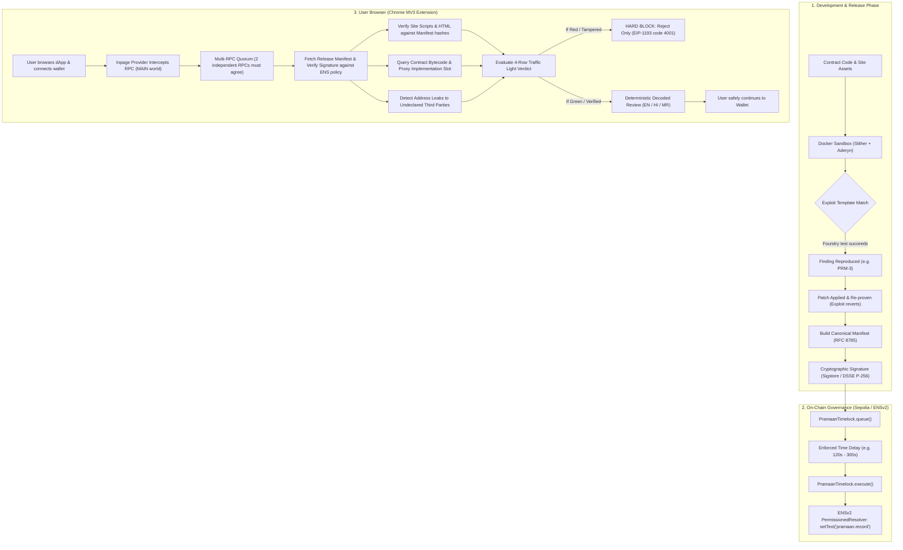

# Pramaan (प्रमाण) — Complete Codebase Architecture, Implementation & Technical Explanation

> **Tagline:** *"Proven before you ship. Verified before you sign."*  
> **Core Concept:** An end-to-end trust chain that connects **autonomous smart contract exploit verification**, **canonical release manifests**, **ENSv2 timelocked on-chain governance**, **browser runtime integrity verification**, and a **deterministic multilingual (English, Hindi, Marathi) transaction decoder**.

---

## Table of Contents
1. [Executive Summary & The Big Picture](#1-executive-summary--the-big-picture)
2. [Why Pramaan Exists (Real-World Problems Solved)](#2-why-pramaan-exists-real-world-problems-solved)
3. [The Complete End-to-End Trust Chain Architecture](#3-the-complete-end-to-end-trust-chain-architecture)
4. [Folder-by-Folder & File-by-File Breakdown](#4-folder-by-folder--file-by-file-breakdown)
   - [4.1 `pramaan/contracts/` (Solidity Smart Contracts)](#41-solidity-smart-contracts)
   - [4.2 `pramaan/packages/engine/` (Autonomous Exploit Engine & Sandbox)](#42-packagesengine-autonomous-exploit-engine)
   - [4.3 `pramaan/packages/manifest/` (Canonical Schema, DSSE & Hashing)](#43-packagesmanifest-release-manifest-system)
   - [4.4 `pramaan/packages/verifier-core/` (Independent Verification Engine)](#44-packagesverifier-core-verification-engine)
   - [4.5 `pramaan/packages/decoder/` (Deterministic Multilingual Decoder)](#45-packagesdecoder-transaction-decoder--i18n)
   - [4.6 `pramaan/packages/release/` (Release Assembly, ENSv2 & IPFS)](#46-packagesrelease-release-pipeline--ensv2)
   - [4.7 `pramaan/apps/extension/` (Chrome Manifest V3 Browser Extension)](#47-appsextension-chrome-extension)
   - [4.8 `pramaan/apps/cli/` (Pramaan CLI Tooling & Demo-Up)](#48-appscli-command-line-interface)
   - [4.9 `pramaan/apps/demo-dapp/` (Demo dApp & Attack Simulations)](#49-appsdemo-dapp-demo-application)
   - [4.10 `pramaan/apps/server/` (Backend Server & Job Worker)](#410-appsserver-fastify-api--queue-worker)
   - [4.11 `pramaan/docker/sandbox/` & `tools/slither-plugin/` (Hardened Analysis Sandbox)](#411-dockersandbox--toolsslither-plugin)
   - [4.12 `pramaan/examples/` (Vulnerable Reference Examples)](#412-examples-vulnerable-reference-targets)
5. [Key Cryptographic & Security Mechanisms Explained Simply](#5-key-cryptographic--security-mechanisms-explained-simply)
6. [The 4-Row Traffic Light Verdict System](#6-the-4-row-traffic-light-verdict-system)
7. [Step-by-Step Flow: How `demo:up` Executes the Entire Lifecycle](#7-step-by-step-flow-how-demoup-runs)
8. [Summary of Accomplishments & Design Innovations](#8-summary-of-accomplishments--design-innovations)

---

## 1. Executive Summary & The Big Picture

In the Web3 ecosystem, users frequently lose hundreds of millions of dollars to phishing, malicious frontend tampering, sneaky smart contract proxy upgrades, and blind-signing incomprehensible hex data.

Traditional solutions fall into two flawed extremes:
1. **Static Analysis & Auditing Tools:** Tools like Slither and Aderyn flood developers with dozens of warnings, most of which are false positives. Developers get warning fatigue and ignore them.
2. **Post-Hoc Wallet Popups:** Wallets show raw hex data or rely on centralized, proprietary APIs and probabilistic AI to guess what a transaction does. Furthermore, wallets cannot verify whether the website delivering the transaction has been compromised on the CDN level.

**Pramaan** (Sanskrit for *"Evidence"*, *"Proof"*, or *"Validation"*) bridges this gap with an unbroken cryptographic chain of custody:
```
Developer writes code
   │
   ▼
[ 1. PROVE ] ──────────► Autonomous Exploit Engine generates real Foundry test cases in
                         a network-less Docker sandbox. "No proof, no finding."
   │
   ▼
[ 2. FIX & RE-PROVE ] ──► Fix is applied (e.g. onlyOwner); exploit is re-run and must fail.
   │
   ▼
[ 3. MANIFEST & SIGN ] ─► Hashes all site files (SRI) + deployed bytecode + proxies + ERC-7730 descriptors.
                         Signed via Sigstore (GitHub Actions CI) or P-256 release key (DSSE).
   │
   ▼
[ 4. ENSv2 TIMELOCK ] ──► Release pointer ("pramaan:v1:<tag>:<sha256>") queued in PramaanTimelock.
                         After delay, written to ENS text key `pramaan.record` using an ENSv2
                         role-scoped PermissionedResolver (cannot touch any other record).
   │
   ▼
[ 5. RUNTIME VERIFY ] ──► Chrome Extension checks ENS pointer via 2 independent RPCs, verifies site
                         file hashes, verifies deployed contract code & proxy implementation, and
                         monitors address leaks.
   │
   ▼
[ 6. CLEAR DECODE ] ────► Deterministically decodes transactions into English, Hindi (हिंदी), and
                         Marathi (मराठी). If site or contract was tampered, signing is HARD BLOCKED!
```

---

## 2. Why Pramaan Exists (Real-World Problems Solved)

| Threat / Problem | Real Incident / Statistic | How Pramaan Solves It |
|---|---|---|
| **Frontend / CDN Compromise (JS Swapping)** | **Bybit $1.5B theft (Feb 2025)**: Attacker replaced JavaScript on AWS S3 to inject a malicious `delegatecall` into Safe slot 0. The smart contracts were completely unhacked, but the frontend was manipulated. | Pramaan computes SHA256/SRI hashes of every site file during release. The browser extension re-hashes loaded scripts. If even 1 byte is modified on the CDN, the verdict turns **RED** and signing is **hard-blocked**. |
| **Sneaky Proxy Implementation Upgrades** | Malicious or compromised admin keys upgrade an ERC-1967/UUPS proxy to an unaudited contract with a hidden backdoor sweep function. | The manifest pins both the proxy address and the implementation bytecode hash (`implCodehash`). The extension inspects slot `0x360894...` on-chain. If implementation code changed without an updated manifest, signing is blocked. |
| **False-Positive Fatigue in Security Scans** | 90%+ of static scanner warnings are non-exploitable noise, causing developers to overlook real vulnerabilities. | **"No proof, no finding"**: Pramaan only reports an issue if a real Foundry exploit test compiles, executes inside a hardened sandbox, and concretely drains funds or seizes ownership. |
| **Blind Signing & Complex Technical Jargon** | Scam Sniffer 2025: $83.85M lost across 106,106 victims; unlimited ERC-20 approvals, Permit, Permit2, and EIP-7702 delegation accounted for 38% of major losses. | Pramaan uses deterministic ABIs and ERC-7730 clear-signing to translate requests into simple human language, available in English, Hindi, and Marathi, highlighting high-risk permissions. |
| **Address Tracking & Privacy Leaks** | USENIX Security '23 & PoPETs '26: 35% of dApps leak connected wallet addresses to 137+ undeclared third-party ad/analytics services. | Pramaan monitors HTTP traffic headers, query parameters, and JSON payloads. If an undeclared third party receives the user's wallet address, it flags an amber/red warning and provides a one-click button to block that domain via Chrome DeclarativeNetRequest. |

---

## 3. The Complete End-to-End Trust Chain Architecture



---

## 4. Folder-by-Folder & File-by-File Breakdown

### 4.1 Solidity Smart Contracts (`pramaan/contracts/`)

The contracts directory contains the core on-chain timelock contract, test harnesses, deployment scripts, and reference demo vaults demonstrating security bugs and fixes.

- **`src/PramaanTimelock.sol`**:
  - The central on-chain anchor of Pramaan.
  - Holds an ENSv2 text-setter role for exactly one text key: `pramaan.record`.
  - Enforces that every pointer starts with `pramaan:v1:` and contains printable ASCII only (`pramaan:v1:<tag>:<sha256>`).
  - Implements role separation:
    - **Proposer** (CI key / automated release pipeline): Allowed only to call `queue(string value)`.
    - **Guardian** (Project owner / Safe multisig): Can `cancel(uint256 id)` a malicious or accidental proposal, or `setProposer(address newProposer)` if a CI secret leaks.
    - **Executor** (Anyone): Can call `execute(uint256 id)` once the ETA (`block.timestamp + delay`) has elapsed.
  - Implements anti-rollback: Executing release $N$ makes every queued proposal with an ID $\le N$ permanently unexecutable (`id > lastExecutedId`).
  - Strict scope: Makes zero arbitrary calls; it can *only* invoke `resolver.setText(dnsName, "pramaan.record", value)`.
- **`src/interfaces/ITextSetter.sol`**:
  - Minimal interface for setting text records: `setText(bytes calldata name, string calldata key, string calldata value)`.
- **`src/demo/VulnerableVault.sol`**:
  - An upgradeable UUPS vault holding ETH and ERC-20 tokens.
  - Contains an intentional vulnerability: `withdrawAll()` was written as an emergency sweep function but **lacks the `onlyOwner` modifier**. Any caller can withdraw all depositors' ETH and tokens.
- **`src/demo/VaultV2.sol`**:
  - The fixed version of `VulnerableVault`.
  - Retains the exact same storage layout, but adds the `onlyOwner` modifier to `withdrawAll()`.
- **`src/demo/VaultV3Unaudited.sol`**:
  - Simulates a sneaky insider attack or compromised admin key.
  - Adds an `operatorSweep(address payable to)` backdoor that allows a hidden address (`OPERATOR = 0x...dEaD`) to steal assets.
  - Used in the demo to prove that when a proxy is updated to an unreleased implementation, Pramaan's extension instantly turns **RED**.
- **`src/demo/DemoToken.sol`**:
  - An ERC-20 token (`TEST`) with 18 decimals, a 1,000 token faucet, and EIP-2612 `permit` support for gasless approvals.
- **`src/demo/DemoNFT.sol`**:
  - An ERC-721 NFT collection (`DemoNFT` / `DNFT`) with a public `mint()` function to demonstrate NFT transfers and `setApprovalForAll` detection.
- **`script/Deploy.s.sol`**:
  - Foundry deployment script that deploys `DemoToken`, `DemoNFT`, `VulnerableVault`, `VaultV2`, and `VaultV3Unaudited`.
  - Automatically exports deployed addresses and runtime bytecode hashes to `deployments/<chainId>.json`.
- **`test/PramaanTimelock.t.sol`**:
  - Unit tests for the timelock covering queueing, delays, grace periods, cancellation, and anti-rollback logic.
- **`test/exploits/WithdrawAllExploit.t.sol`**:
  - Proves that `WithdrawAllExploitTest` successfully drains `VulnerableVault`, but reverts with `OwnableUnauthorizedAccount` when run against `VaultV2`.
- **`test/fork/ENSv2Timelock.fork.t.sol`**:
  - Fork test run against live Ethereum Sepolia state where ENSv2 contracts reside.
  - Exercises `VerifiableFactory`, deploys a real `PermissionedResolver` proxy, and proves that `grantSetterRoles` strictly isolates the timelock to the `pramaan.record` key while rejecting unauthorized writes.

---

### 4.2 Autonomous Exploit Engine (`pramaan/packages/engine/`)

This package powers the `pramaan prove` workflow. Instead of acting as an unconstrained generative AI auditor, it uses a **template-driven proof engine** that generates deterministic Foundry exploit contracts and verifies them inside a hardened Docker sandbox.

- **`pipeline.ts`**:
  - Coordinates the entire analysis lifecycle:
    1. Collects candidates from static scanners (Slither, Aderyn).
    2. Maps candidates to exploit templates.
    3. Runs static security gates on generated tests.
    4. Executes the exploit against the vulnerable codebase inside the Docker sandbox.
    5. If the exploit passes (funds drained or ownership seized), it records the finding as `reproduced`.
    6. Proposes a code fix and re-executes the test against the patched codebase (which must now revert).
    7. Runs the project's original regression test suite to ensure the fix didn't break legitimate behavior.
    8. Generates `evidence.json` and a Markdown summary report.
- **`candidates.ts`**:
  - Normalizes raw outputs from Slither and Aderyn into uniform `Candidate` structures with contract name, function signature, file, line numbers, and vulnerability classification (`access-control`, `reentrancy`, `initializer-takeover`, etc.).
- **`templates.ts`**:
  - Contains concrete Foundry test skeletons:
    - `access-control-drain`: Exploits unprotected functions that transfer contract balances.
    - `reentrancy-eth`: Deploys an attacking contract with a `receive()` hook to exploit check-effects-interactions violations.
    - `initializer-takeover`: Calls uninitialized or unguarded initialization functions to hijack ownership.
  - Slots within templates (e.g. constructor parameters, deposit amounts) are filled via AST heuristics, `pramaan.json` target configs, or optional AI assistance.
- **`gates.ts`**:
  - Static safety checks that must pass before any test is allowed to run:
    - **G1 (Slot Vocabulary):** Ensures slot values only use safe expressions (e.g., `makeAddr(...)`, `SEED`, `true`), preventing arbitrary code injection into the test.
    - **G2 (No State-Forging Cheatcodes):** Ensures the test does not forge state using `vm.store`, `vm.etch`, `vm.mockCall`, or `deal(target)`.
    - **G3 (Attacker-Only):** Ensures the attack phase uses `vm.prank(attacker)` and never impersonates the owner.
    - **G4 (Concrete Assertion):** Checks that the test asserts a real balance gain (`assertGt(attacker.balance, ...)`) or owner takeover.
- **`sandbox.ts`**:
  - Invokes `docker run` with maximum isolation:
    - `--network none` (zero network access).
    - `--read-only` root filesystem.
    - `--tmpfs /work` and `/tmp` with `nosuid, nodev, noexec`.
    - `--cap-drop ALL` (drops all Linux capabilities).
    - `--security-opt no-new-privileges`.
    - Non-root user `1000:1000`.
    - Memory and CPU limits with timeout enforcement.
- **`fixers.ts`**:
  - Deterministic automated patch generator. For example, for an unprotected sweep in an Ownable contract, it injects the `onlyOwner` modifier onto the function declaration.
- **`ai.ts`**:
  - Optional module (used when `--ai` is supplied with an Anthropic API key). Only fills template slots or drafts patches if heuristics fail; cannot declare a bug valid without passing the sandbox execution gates.
- **`forge.ts` & `workspace.ts`**:
  - Manages test workspaces, parses Forge JSON outputs, and checks test regression results.
- **`evidence.ts` & `report.ts`**:
  - Produces RFC 8785 canonical `evidence.json` documents and human-readable Markdown reports.

---

### 4.3 Release Manifest System (`pramaan/packages/manifest/`)

This package defines the canonical schema and cryptographic serialization formats for Pramaan release manifests and proof evidence.

- **`schema.ts`**:
  - Zod schemas validating every component of a release:
    - `FileEntry`: Relative site path, lowercase 64-hex SHA-256, Subresource Integrity (SRI) string, file size.
    - `ContractEntry`: Target chain ID, address, runtime bytecode hash (`runtimeCodehash`), proxy metadata (type, implementation address, implementation code hash), and Sourcify status.
    - `FindingEntry`: Finding ID (`PRM-X`), severity, status (`reproduced`, `fixed-verified`), exploit test SHA256, evidence SHA256, and fix commit.
    - `DescriptorEntry`: Pinned ERC-7730 Clear Signing JSON file paths and hashes.
    - `ThirdPartyEntry`: Permitted third-party domains, stated purpose, and whether they are allowed to receive wallet addresses.
    - `ManifestV1`: The full top-level release manifest.
    - `WellKnownHint`: The schema for `/.well-known/pramaan.json` (treated as an unverified hint; re-checked on-chain).
- **`canonical.ts`**:
  - Implements **RFC 8785 JSON Canonicalization Scheme (JCS)**. Guarantees that JSON keys are sorted lexicographically, numbers are serialized consistently, and whitespace is removed so that two independent systems compute the exact same SHA256 digest over the manifest.
- **`pointer.ts`**:
  - Encodes and parses the ENS pointer string: `pramaan:v1:<tag>:<sha256>`.
- **`dsse.ts`**:
  - Implements **Dead Simple Signing Envelope (DSSE)** for in-toto attestations. Handles payload pre-authentication encoding (`PAE(payloadType, payload)`) and signature verification.
- **`cid.ts` & `hash.ts`**:
  - Generates raw IPFS CIDs (`bafkrei...`) directly from SHA256 digests and computes SRI hashes.
- **`node.ts`**:
  - Node.js-specific cryptographic utilities: P-256 key generation, PEM parsing, and ECDSA signature creation using `node:crypto`.

---

### 4.4 Verification Engine (`pramaan/packages/verifier-core/`)

The heart of Pramaan's independent verification. It contains zero browser-specific code and can run both in Node.js (CLI / Server) and inside the browser extension.

- **`verdict.ts`**:
  - Combines individual verification checks into a cohesive 4-row verdict:
    1. **Site Row:** Verified, Mismatch, Unlisted Script, or Revoked.
    2. **Contract Row:** Verified, Unlisted Contract, Code Mismatch, Implementation Mismatch, Unsupported Proxy, or EOA.
    3. **Action Row:** Risk level of the decoded action (Info, Low, Medium, High, Critical).
    4. **Privacy Row:** Undeclared address leak (Red), Declared leak (Amber), Blocked (Green), or None Observed (Green).
  - Calculates the overall verdict color (Green, Amber, Red). If any critical check fails, sets `blocked = true`.
- **`contracts.ts`**:
  - Deployed contract inspector.
  - Reads runtime bytecode via `eth_getCode` and computes `keccak256(code)`.
  - Implements proxy detection in exact order:
    1. **EIP-7702**: Account delegation code `0xef0100<address>`.
    2. **EIP-1167**: Minimal clone bytecode pattern.
    3. **EIP-1967**: Implementation storage slot `0x360894a13ba1a3210667c828492db98dca3e2076cc3735a920a3ca505d382bbc`.
    4. **EIP-1967 Beacon**: Beacon slot `0xa3f0ad74...`.
    5. **EIP-1822**: Proxiable slot `0xc5f16f0f...`.
    6. **Safe Singleton**: MasterCopy address in slot 0.
    7. **EIP-2535 Diamonds**: Detects facet selectors; flagged as unsupported rather than guessed.
  - Compares inspected addresses against the manifest: verifies both the proxy wrapper and the underlying logic implementation bytecode.
- **`ens.ts`**:
  - Resolves text records from ENS names using universal resolvers.
  - Queries all Pramaan records: `pramaan.record`, `pramaan.domain`, `pramaan.repo`, `pramaan.attestation`, `pramaan.signer`, `pramaan.revoked`.
  - Implements DNS wire-format encoding for ENSv2 subnames.
- **`rpc.ts`**:
  - Multi-RPC consensus engine. Queries multiple independent RPC endpoints concurrently and requires agreement. Prevents a malicious or rogue RPC provider from tricking the verifier.
- **`signature.ts`**:
  - Verifies release signatures according to the policy specified in ENS:
    - **GitHub mode:** Validates Sigstore bundle certificates issued by Fulcio under the GitHub OIDC issuer, verifying repository and release workflow paths.
    - **Key mode:** Validates ECDSA P-256 signatures against the public key declared in the `pramaan.signer` ENS record.
- **`site.ts`**:
  - Validates web assets loaded by the page against the release manifest:
    - Same-origin scripts and HTML documents matching hashes $\rightarrow$ Verified.
    - Any modified file $\rightarrow$ **RED (Mismatch)**.
    - Any unlisted same-origin script or iframe $\rightarrow$ **RED (Unlisted Script)**.
    - Declared third-party scripts $\rightarrow$ Allowed.
    - Undeclared third-party scripts $\rightarrow$ Flagged.
- **`release.ts`**:
  - High-level coordinator that resolves ENS, checks domain binding (`pramaan.domain == origin`), fetches manifest, and checks signature validity.
- **`sourcify.ts`**:
  - Checks bytecode verification status against Sourcify (`exact_match`, `match`, etc.).

---

### 4.5 Transaction Decoder & i18n (`pramaan/packages/decoder/`)

Pramaan explicitly rejects using blackbox AI for live transaction decoding. An LLM can hallucinate or fail silently on edge cases. Instead, Pramaan uses a **100% deterministic ABI decoder, rule-based risk analyzer, and localized template catalog**.

- **`decode.ts`**:
  - Decodes transactions and signatures using standard ABIs or release-pinned ERC-7730 descriptors:
    - **ERC-20:** `transfer`, `approve`, `transferFrom`, `increaseAllowance`.
    - **ERC-721 / ERC-1155:** `safeTransferFrom`, `setApprovalForAll`, `approve`.
    - **Permit & Permit2:** EIP-2612 signatures and Uniswap Permit2 batch approvals.
    - **Safe {Wallet}:** `execTransaction` decoding. Crucially detects `operation == 1` (`DELEGATECALL`), the exact vector used in the Bybit hack!
    - **Multicall:** Unpacks nested batch calls (`aggregate3`, `multicall`).
    - **Account Abstraction & EIP-7702:** Account delegation authorizations.
    - **Signatures:** EIP-712 typed data, Sign-In with Ethereum (SIWE), `personal_sign`, and `eth_sign`.
- **`risk.ts`**:
  - Evaluates security risk codes:
    - `UNLIMITED_APPROVAL`: Token allowance is set to maximum (`2^256 - 1`).
    - `SAFE_DELEGATECALL`: Safe transaction executes a delegatecall (can overwrite Safe storage slot 0).
    - `EIP7702_DELEGATION`: Account code hijacked by an external delegate contract.
    - `ETH_SIGN`: Dangerous blind signing of raw 32-byte hashes.
    - `SIWE_DOMAIN_MISMATCH`: Sign-in message domain differs from the actual browser tab origin (phishing detection).
    - `APPROVAL_TO_EOA`: Token approval granted to a private key wallet instead of a verified contract.
- **`i18n.ts`**:
  - Multilingual translation templates for every action, risk code, and verdict explanation:
    - **English (`en`)**
    - **Hindi (`hi` - हिंदी)**: e.g. *"{spender} को आपके {token} असीमित रूप से खर्च करने की अनुमति दें"*
    - **Marathi (`mr` - मराठी)**: e.g. *"{spender} ला तुमचे {token} अमर्यादित खर्च करण्याची परवानगी द्या"*
- **`clearsign.ts`**:
  - Adapter for ERC-7730 clear-signing descriptors pinned in the manifest.
- **`format.ts` & `abis.ts`**:
  - Number formatting, address abbreviations, token decimals handling, and known contract ABIs.

---

### 4.6 Release Pipeline & ENSv2 Integration (`pramaan/packages/release/`)

This package automates building the manifest, interacting with the real ENSv2 contracts, and deploying timelocks.

- **`assemble.ts`**:
  - Crawls the built website directory, computes SHA-256 and SRI for all files, queries RPC for deployed contract codehashes and proxy implementations, and builds the canonical `ManifestV1` object.
- **`ens.ts`**:
  - Interacts with ENSv2 contracts:
    - `deployResolver`: Deploys a dedicated `PermissionedResolver` proxy via `VerifiableFactory` and initializes it with owner records (`pramaan.domain`, `pramaan.repo`, `pramaan.attestation`, `pramaan.signer`).
    - `grantRecordRole`: Calls `grantSetterRoles` on the resolver to give the timelock contract `ROLE_SET_TEXT` on `keccak256("pramaan.record")` only.
    - `registerName`: Registers an ENS name via commit-reveal, paying with Sepolia MockUSDC.
- **`timelock.ts`**:
  - Connects to `PramaanTimelock`: reads operation state, queues pointers, and executes matured proposals.
- **`chain.ts` & `abis.ts`**:
  - Viem client setup, transaction submission helpers, and ENSv2 contract ABIs (`VerifiableFactory`, `ETHRegistry`, `ETHRegistrar`, `PermissionedResolver`).
- **`ipfs.ts`**:
  - Uploads manifests to IPFS via local Kubo RPC nodes or Pinata JWT, verifying retrieval against expected SHA-256 hashes.

---

### 4.7 Chrome Extension (`pramaan/apps/extension/`)

Built under Chrome **Manifest V3 (MV3)**, the extension intercepts transaction attempts, executes cryptographic checks, and displays the interactive review verdict before the user can sign.

- **`manifest.json`**:
  - MV3 manifest declaring permissions: `storage`, `webRequest`, `declarativeNetRequest`, `activeTab`, and content scripts running at `document_start`.
- **`src/inpage.ts`**:
  - Injected directly into the website's **MAIN world** before any dApp scripts run.
  - Wraps `window.ethereum` and EIP-6963 provider announcements.
  - Intercepts all value-moving and signing RPC methods (`eth_sendTransaction`, `eth_signTypedData_v4`, `personal_sign`, etc.).
  - Pauses the request and sends a message to the content script via `window.postMessage`.
  - If the user or extension rejects the request, it throws standard EIP-1193 rejection error (`err.code = 4001`).
- **`src/content.ts`**:
  - Runs in the isolated world; acts as a secure MessageChannel bridge between `inpage.ts` and the extension background worker.
- **`src/background/index.ts`**:
  - The extension service worker entrypoint. Listens for tab updates, web requests, and incoming transaction approvals.
- **`src/background/guard.ts`**:
  - Manages guarded requests:
    1. Triggers verification of the active tab's site release and contracts.
    2. Runs `analyzeRequest()` from `@pramaan/decoder`.
    3. Assembles the 4-row verdict (`siteRow`, `contractRow`, `actionRow`, `privacyRow`).
    4. Opens the popup window `verdict.html?id=...`.
    5. Crucially enforces: **If `verdict.blocked == true`, the "Continue" decision is rejected.** The user cannot proceed when a release violation occurs.
- **`src/background/privacy.ts`**:
  - Observes network requests via `chrome.webRequest.onBeforeRequest` and `onBeforeSendHeaders`.
  - Scans URLs, request headers, and JSON request bodies for the connected wallet address.
  - Compares the recipient domain against the manifest's `thirdParties` list.
  - If undeclared, alerts the user and provides dynamic blocking via `chrome.declarativeNetRequest.updateSessionRules`.
- **`src/pages/verdict.ts` & `verdict.html`**:
  - The transaction approval UI window:
    - Displays traffic light status dots and detailed explanations.
    - Allows the user to switch languages instantly between **English**, **Hindi (हिंदी)**, and **Marathi (मराठी)**.
    - Shows translated risk alerts and raw calldata.
    - Disables the "Continue" button if the website or contract is blocked.
- **`src/pages/popup.ts` & `popup.html`**:
  - The toolbar extension popup. Shows whether the current website matches its published release, lists verified smart contracts, and displays any third-party address leaks observed on the page.

---

### 4.8 Command Line Interface (`pramaan/apps/cli/`)

- **`src/index.ts`**:
  - Full CLI interface offering commands:
    - `pramaan prove <dir>`: Runs Slither/Aderyn, generates Foundry exploit tests, executes sandbox proofs, and verifies fixes.
    - `pramaan keygen`: Generates ECDSA P-256 release keys.
    - `pramaan manifest`: Assembles canonical manifest from a built site directory and deployment records.
    - `pramaan sign`: Signs manifests with a DSSE envelope.
    - `pramaan publish`: IPFS uploading and timelock queueing.
    - `pramaan ens check|status|setup|execute|cancel|negative-test`: Complete ENSv2 management suite.
    - `pramaan verify <url>`: Independently verifies any live website, manifest, and contract bytecode without needing the browser extension.
    - `pramaan decode`: Deterministically decodes transactions into English, Hindi, and Marathi on the terminal.
- **`src/demo-up.ts`**:
  - One-command end-to-end local demonstration script (`pnpm demo:up`). See [Section 7](#7-step-by-step-flow-how-demoup-runs) for full details.

---

### 4.9 Demo Application (`pramaan/apps/demo-dapp/`)

A realistic decentralized finance vault application (`Kosh Vault`) created with Vite and TypeScript.

- **`src/main.ts` & `src/wallet.ts`**:
  - Vault user interface allowing users to connect their wallet, mint test tokens, deposit ETH/tokens, approve allowances, and test withdrawal functions.
- **`src/leak.ts` & `leak.html`**:
  - A test harness page that deliberately sends the user's wallet address to a simulated third-party analytics collector (`http://127.0.0.1:5190/collect`) to test address leak detection and blocking.
- **`scripts/build.mjs`**:
  - Builds two copies of the frontend:
    1. `dist/`: The genuine, unaltered production build.
    2. `dist-tampered/`: A simulated compromised build where a malicious script has been injected to steal tokens.
- **`server/serve.mjs`**:
  - Multi-port local server simulating production environments:
    - Port `5180`: The genuine site.
    - Port `5181`: A lookalike phishing origin (genuine files hosted on an unapproved domain).
    - Port `5189`: Admin endpoint allowing one-click toggling between `genuine` and `tampered` modes to demonstrate real-time attack detection.
    - Port `5190`: Simulated third-party tracking collector.

---

### 4.10 Fastify API & Queue Worker (`pramaan/apps/server/`)

A developer-facing backend for teams running continuous security verification.

- **`src/worker.ts`**:
  - Background worker that claims analysis jobs using PostgreSQL `FOR UPDATE SKIP LOCKED`. Clones repositories, runs the sandbox engine, stores findings, and generates fix proposals.
- **`src/queue.ts` & `src/db.ts`**:
  - Job queueing and database layer supporting both standard PostgreSQL and embedded PGlite for local testing.
- **`src/auth.ts`**:
  - Session authentication via **Sign-In with Ethereum (SIWE)** and API key tokens for CI pipelines.
- **`src/migrations.ts`**:
  - Database schemas tracking projects, jobs, scan results, exploit tests, evidence files, and fix proposals.

---

### 4.11 Hardened Analysis Sandbox (`pramaan/docker/sandbox/` & `tools/slither-plugin/`)

- **`docker/sandbox/Dockerfile`**:
  - Debian-based container pinned with Foundry 1.8.7, Slither 0.11.6, Aderyn 0.6.8, and multiple pre-installed Solc versions (`0.8.20` through `0.8.38`).
- **`docker/sandbox/runner.py`**:
  - Internal sandbox runner script.
  - Sanitizes `foundry.toml` by stripping unsafe keys and forcing `ffi = false` and `fs_permissions = []`.
  - Runs compilation and exploit tests without network access, returning structured JSON via standard output marker `@@PRAMAAN_RESULT@@`.
- **`tools/slither-plugin/pramaan_slither/detectors.py`**:
  - Custom Slither vulnerability detectors written in Python:
    - `PramaanUnprotectedSweep`: Detects functions moving the contract's entire ETH or token balance without access modifiers.
    - `PramaanUnprotectedInitializer`: Detects initialization functions setting admin state that can be re-called after deployment.

---

### 4.12 Vulnerable Reference Targets (`pramaan/examples/`)

Self-contained target repositories used to test and prove exploit templates:
- **`examples/reentrancy-bank/`**:
  - `src/EtherBank.sol`: Classic reentrancy vulnerability (`msg.sender.call{value: amount}("")` before setting `balances[msg.sender] = 0`).
  - `src/EtherBankFixed.sol`: Checks-effects-interactions fix.
- **`examples/initializer-takeover/`**:
  - `src/RewardsPool.sol`: Initialization function missing the `initializer` modifier.
  - `src/RewardsPoolFixed.sol`: Guarded initializer.

---

## 5. Key Cryptographic & Security Mechanisms Explained Simply

### 5.1 "No Proof, No Finding"
Rather than giving developers a list of 50 speculative warnings, Pramaan automatically turns a candidate into an executable Foundry test (`.t.sol`). If the test runs in the sandbox and drains assets, it is a proven vulnerability. If the test cannot reproduce the issue, it is not reported as a confirmed vulnerability.

### 5.2 Key-Scoped ENSv2 Role Delegation
Under ENSv2, access control is governed by `PermissionedResolver`. Instead of granting an admin master access, the owner grants `ROLE_SET_TEXT` strictly to `keccak256("pramaan.record")`. The timelock contract—and by extension, the CI proposer key—is mathematically incapable of altering the dApp's domain, repository, or owner addresses on ENS.

### 5.3 Anti-Rollback Timelock
When a new release pointer is queued, it must wait out a security delay (e.g., 5 minutes or 2 days). If an attacker compromises the CI key and queues an older, vulnerable version, the guardian can cancel it during the delay. Furthermore, executing release #5 permanently invalidates releases #1 through #4, preventing replay attacks.

### 5.4 Subresource Integrity (SRI) & Site Hashing
Every HTML file, script, stylesheet, and asset is hashed. When the user visits the dApp, the Chrome extension calculates the hash of the loaded files. If an attacker tampers with a single character in the JavaScript bundle (such as replacing a recipient address or adding a malicious `delegatecall`), the hash check fails and signing is immediately blocked.

### 5.5 Proxy Implementation Storage Slot Verification
Attackers often leave the proxy wrapper untouched and upgrade the implementation behind it. Pramaan inspects the EIP-1967 storage slot (`0x360894...`) directly on the Ethereum blockchain and compares the implementation contract's bytecode against the pinned release manifest.

---

## 6. The 4-Row Traffic Light Verdict System

When a transaction or signature request is initiated, the extension pops up an intuitive review window containing 4 distinct verification rows:

| Row | What It Checks | Green Indicator | Amber Indicator | Red Indicator (Blocks Signing) |
|---|---|---|---|---|
| **1. Site Integrity** | Website files, HTML, and JS bundles | All files match the signed release manifest exactly. | Site publishes no release, or release is unverified. | **File mismatch or unlisted script injected into page.** |
| **2. Contract Status** | Bytecode & proxy implementation | Deployed contract and proxy implementation match the manifest. | Contract is unlisted or uses an unsupported proxy. | **Bytecode mismatch or implementation proxy swapped.** |
| **3. Action & Risk** | Calldata meaning & dangerous permissions | Safe action (e.g. standard transfer, revoking approval). | Medium risk (e.g. unknown action, approval to contract). | **High/Critical risk (Unlimited approval, Safe delegatecall, EIP-7702).** |
| **4. Privacy Leaks** | Connected wallet address transmission | No address leaks observed, or undeclared tracker blocked. | Address sent to a declared third party (e.g. RPC node). | **Address leaked to an undeclared third-party tracking service.** |

---

## 7. Step-by-Step Flow: How `demo:up` Runs

When you execute `pnpm demo:up`, the CLI orchestrates the full lifecycle automatically:

1. **Launches Anvil Sepolia Fork:** Forks Ethereum Sepolia locally at block height with all real ENSv2 contracts present.
2. **Generates Local Signers:** Generates distinct accounts for the Owner, CI Proposer, User, and Marketplace Operator.
3. **Deploys Demo Contracts:** Deploys `DemoToken`, `DemoNFT`, `VulnerableVault` (UUPS proxy), `VaultV2`, and `VaultV3Unaudited`.
4. **Autonomous Proof (PROVE):** Runs Slither and Aderyn inside the Docker sandbox. Matches `PRM-3` (unprotected `withdrawAll()`), generates Foundry exploit test `PramaanExploit_PRM_3.t.sol`, runs it, proves asset drainage, applies the `onlyOwner` fix, and verifies that the exploit now reverts.
5. **Configures ENSv2 & Timelock:**
   - Deploys dedicated `PermissionedResolver` proxy via `VerifiableFactory`.
   - Deploys `PramaanTimelock` with a 120-second delay.
   - Grants the timelock key-scoped `ROLE_SET_TEXT` on `pramaan.record`.
   - Registers name `kosh-XXXXXX.eth` using commit-reveal and Sepolia test MockUSDC.
   - Executes negative tests: confirms that attempting to write records directly with the proposer key reverts.
6. **Builds Genuine & Tampered dApps:** Builds `dist/` (genuine) and `dist-tampered/` (simulated attack).
7. **Assembles & Signs Manifest:** Generates `pramaan-manifest.json` with file hashes, contract codehashes, finding evidence, and ERC-7730 clear-signing descriptors. Signs it with DSSE.
8. **Timelock Queue & Execution:** Queues release pointer `pramaan:v1:v1.0.0:<hash>` into `PramaanTimelock`, fast-forwards Anvil time past the delay, and executes the pointer update to ENS.
9. **Spawns Local Servers:** Launches the genuine dApp (`http://localhost:5180`), the lookalike phishing site (`http://127.0.0.1:5181`), the admin toggle (`http://127.0.0.1:5189/mode`), and the address tracking collector (`http://127.0.0.1:5190/collect`).

---

## 8. Summary of Accomplishments & Design Innovations

1. **Complete Chain of Trust:** Unites pre-deployment automated bug reproduction with post-deployment user signing verification.
2. **First Real Use of ENSv2 Key-Scoped Roles:** Demonstrates practical usage of ENSv2's `PermissionedResolver` and `grantSetterRoles` to restrict an on-chain timelock to a single text key.
3. **Bybit Attack Immunity:** Eliminates the vulnerability that caused the $1.5B Bybit theft by verifying frontend subresource integrity and detecting Safe `DELEGATECALL` operations.
4. **Zero-AI Deterministic Safety:** Transaction decoding uses deterministic bytecode/ABI analysis rather than error-prone large language models.
5. **Multilingual Inclusivity:** Full transaction and risk explanations in English, Hindi (हिंदी), and Marathi (मराठी).
6. **Active Privacy Defense:** Inspects live network payloads for wallet address leakage and gives users one-click blocking controls.

