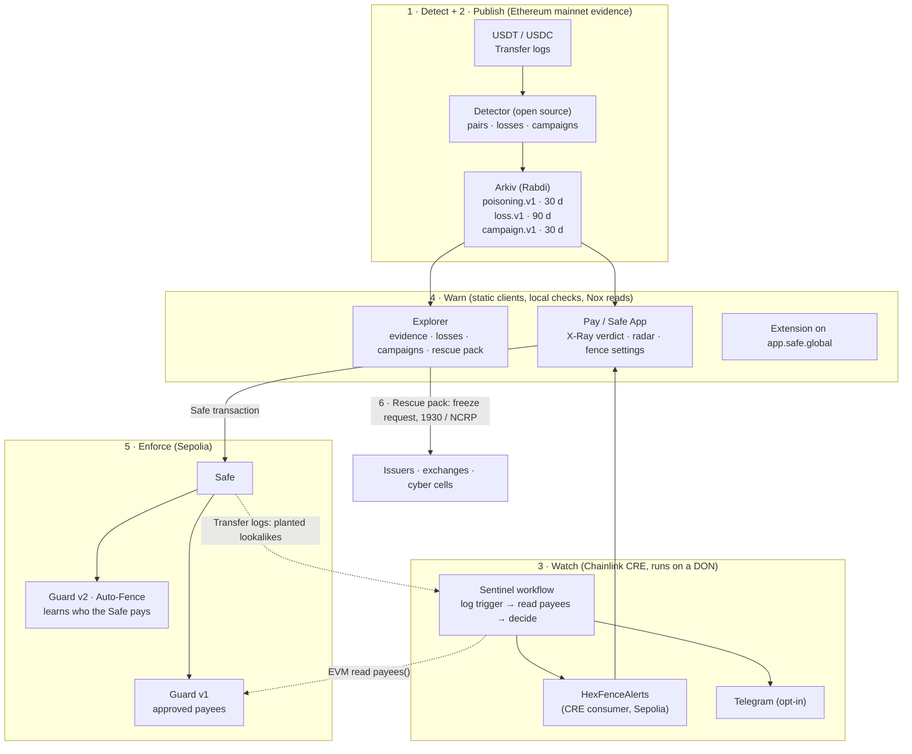

# HexFence 2.0: the upgrade plan

**Features, UI, the third sponsor and the path to a win at ETHGlobal Mumbai 2026**

Team Code Icon · Fri 6 Nov 2026, about 13:00 IST · Submission due Sat 7 Nov, 09:00 IST (aim for 08:30)

**What this is based on:** the GitHub `main` branch at `7b12aa5` (12:06 IST); the live landing page, explorer and Pay, checked in a browser today; the locked spec `10_FINAL_What_To_Build_HexFence`; Pramaan in `9_Four_Ideas_Priority`; TraceBack in `fraud-tracer/docs`; and web research. Sources are listed at the end.

> **Before anyone builds:** the local folder `D:\Deven\1_Hackathon_proj\my\eth\hexfence` is at `c81018e` (10:02 IST). GitHub `main` is 23 commits ahead: it has the landing page, the explorer data views, the Pay preview and setup panel, and the extension. Pull first: `git fetch origin && git switch main && git pull --ff-only`.

---

## 0. The answer on one page

**HexFence today:** a Safe Guard that refuses a payment to any address that shares an approved payee's first 4 and last 4 hex characters but is a different address. Around it sit a mainnet detector that publishes suspected poisonings to Arkiv, an explorer, and HexFence Pay, with Nox reads and Hindi text. It works end to end on Sepolia with real mainnet evidence.

**What judges will push on:**

1. *"Who maintains the approved-payee list?"* Most Safes never will, so most Safes get no protection.
2. It only acts at the moment of payment. Nothing watches the Safe, and nothing happens after someone has been hit.
3. The rule itself is simple (the spec calls it "incremental"), and the UI is mostly text and forms.

**HexFence 2.0 in one sentence:**
> *Your Safe remembers who it pays, watches for their lookalikes around the clock, refuses them on-chain, and helps you act if someone was hit, with open evidence anyone can check.*

**What to build before the 22:00 freeze, in four parallel lanes:**

| # | Feature | Why it moves the score | Suggested owner | Hours |
|---|---|---|---|---|
| **A1** | **Auto-Fence.** A new Guard v2 learns every recipient the Safe pays and refuses their lookalikes. This is trust on first use, like SSH `known_hosts`, enforced on-chain. Zero setup. It also fixes review finding 1 (ETH sent with calldata). | **Originality + practicality.** It answers the "who maintains the list" question. | Baqir + Codex | 4–5 |
| **A2** | **Sentinel on Chainlink CRE** (the third sponsor). A log-triggered workflow spots a lookalike planted in your Safe's history, checks it against the Guard's payees, writes an on-chain alert and sends a Telegram message. | **WOW + a new sponsor + CROPS "C".** No HexFence server is involved. | Deven + Claude #1 | 5 |
| **A3** | **Lookalike X-Ray UI.** One design system. A side-by-side diff of the two addresses in 4-character groups, with a colour code for the whole address. The verdict appears as you paste, with an alert banner. | **Usability.** The idea becomes visible in one second on camera. | Dhruv + Claude #2 | 5 |
| **A4** | **Rescue v0** (taken from TraceBack). The detector also finds *successful* poisonings, where the victim later paid the lookalike. The explorer gets a "Losses" tab with real totals, the balance still sitting at the lookalike, and a freeze-request evidence pack. | **Real money numbers.** It takes the story from prevention to response. | Akshat, with any free agent | 4 |

**Third sponsor: Chainlink, "Best workflow with CRE" ($1,500).** It is the missing "Watch" stage of the product, simulation counts, and the workflow reads the Guard (and optionally Arkiv), so all three sponsors meet in one flow. Every other option is scored in §8.

**The WOW moment in the demo:** we play the attacker live. One zero-value `transferFrom` plants a lookalike in the demo Safe's history, and Sentinel turns it into an on-chain alert and a phone notification. Pay shows the X-Ray, and paying the lookalike reverts on-chain. Then a *brand-new Safe with no setup at all* refuses a lookalike of the one supplier it has paid once.

**Don't break what works:** the v1 Guard, its 14 tests, the T8 hashes and today's demo stay exactly as they are. v2 is a **new contract on a new, isolated Safe.** Any lane that isn't green by 19:00 IST gets cut (cut order in §12).

---

## 1. Audit: where HexFence stands now

### 1.1 What already works (keep all of it)

| Part | State, with the evidence |
|---|---|
| `HexFenceGuard` v1 | Live on Sepolia at `0xA061…9748`, exact match on Sourcify, 14 tests, and a parity test against the real Guard on 411 transactions. The lookalike payment reverted on-chain, B and P went through, and the removal drill passed. |
| Detector | One run read 1,366,618 USDT/USDC logs (blocks 26345544–26352743) and found **47,694 suspected pairs**: 36,382 zero-value and 11,312 dust. 40 of 40 sampled records were confirmed against receipts. Attack transactions poison 170+ victims each, and 10-character matches show up about 9× more often than chance would give. |
| Arkiv | 173 records, idempotent writes, 30-day expiry, bulk reads, and a query judges can run. |
| Explorer | Loads every record, has data views, checks your own address in the browser, and offers "Verify on Ethereum". |
| Pay | Read-only preview, RED / AMBER / GREEN / GREY verdicts, the 6-character friction step, Nox reads, Hindi, and an owner setup panel (unit-tested only). |
| Extension | Built, but not yet tested on Safe{Wallet} (T14 go/no-go pending). |
| Docs | CROPS section, the five `arkiv/*.md` files, the honesty rules, and full AI-usage records. This is better than most teams have. |

### 1.2 Gaps, ranked by what they cost in judging

| # | Gap | Evidence | Fixed by |
|---|---|---|---|
| 1 | **Setup burden.** Only payees that someone approved by hand are protected. | Guard design; the setup panel hasn't been used with a real wallet | A1 Auto-Fence |
| 2 | **Acts only at payment time.** No watching, no alerts. | No component for it | A2 Sentinel |
| 3 | **Nothing after a loss.** | Blockaid: about 1 attempt in 200 gets paid. Webacy: one victim paid the same lookalike **22 times in 3 h 21 min** ($792,000). | A4 Rescue + A2 |
| 4 | **Coverage holes.** ETH sent with non-empty calldata isn't checked (your `GUARD_REVIEW.md` finding 1). MultiSend is refused, so Safe{Wallet} batches revert. Module transactions bypass the Guard. Owner and module changes aren't checked. | `GUARD_REVIEW.md`, README limits | A1 (value fix); B4 and B5 later |
| 5 | **Thin evidence views.** 173 of 47,694 records are published. The timeline is in block ranges, and there's no campaign view. | Explorer | A4 + B2 |
| 6 | **UI.** The landing page is all text. Pay is a long form, and its 26–38 s Nox start-up blocks loading the Safe. Explorer cards are tall. The Pay bundle is about 1.6 MB. | Browser check, §1.3 | A3 |
| 7 | **Originality.** "Deny by resemblance" on its own is incremental. | Spec §5, "Honest notes" | A1 + A2 + A4 together |

### 1.3 UI audit of the live site (checked 6 Nov)

- **Landing:** a tidy dark green theme, but it's all words. The core idea (two addresses that *look* the same) is never shown as a picture. There are no live numbers, and both call-to-action cards carry the same weight.
- **Explorer:** the data views are plain bar lists. "Records over time" is labelled with raw block ranges (`26345676–26346264`), which nobody can read as time. The last bucket shows 129 of 173 records because of how they were published, so it looks like a spike that isn't real. Each record is a tall card, so only two fit on a screen.
- **Pay:** four stacked form sections. Loading a Safe waits for Nox, which took about 30 s in my test and 26–38 s in your hosted runs. The verdict is text only: it names the approved payee but doesn't show *where* the two addresses differ. You have to press "Check payment", and there's no alert or history view.
- **Across all three:** styles were unified only this morning. There's no shared component set. The Pay JavaScript bundle is about 1.6 MB, because Protocol Kit and Nox load up front.

---

## 2. The problem in 2026, with fresh numbers

| Fact | Source |
|---|---|
| **65.4 M** address-poisoning transactions flagged since Jan 2025 (over 160,000 a day). About **316,000** were cases where the victim then sent funds, roughly 1 attempt in 200. | Blockaid, 9 Mar 2026 |
| Attempts rose **5.5×**, from 628,000 in Nov 2025 to 3.4 M in Jan 2026. Ethereum overtook BSC as the most poisoned chain. | Blockaid, 9 Mar 2026 |
| In the 90 days after the Fusaka upgrade (fees dropped), dust transfers rose: USDT 4.2 M → 29.9 M (**+612 %**), USDC 2.6 M → 14.9 M (+473 %). One case saw 13 poison transfers within minutes of a single real USDT payment. | Etherscan, 9 Mar 2026 |
| Two users lost **$50 M** (Dec 2025) and **$12.2 M** (Jan 2026) by copying a lookalike address from their history. | Scam Sniffer via GN Crypto, Feb 2026 |
| Over two years on Ethereum and BSC: **270 M** attack transfers, **17 M** victims targeted, at least **$83.8 M** lost in 6,633 incidents. | USENIX Security 2025 |
| In Sept 2025, one Polygon victim paid the same lookalike **22 times in 3 h 21 min** (36,000 USDC each, $792,000 in total). The median gap between payments in a burst was about 3 min. | Webacy, Sept 2025 |
| Of **53** Ethereum wallets tested, **only 3** show an explicit warning when you send to a phishing address. | Guan & Li, arXiv 2508.12107 |
| Safe users specifically: about **15,000** lookalike proxy addresses targeted them, and one "nested Safe" campaign created about 200 lookalike Safes in a single transaction. Safe{Wallet} now flags these in its interface. | Blockaid; Safe Help Center; EdgeX news, Sept 2026 |
| 2023 Safe case: $2.05 M lost in one week, because Safe's history page showed only the last 4 characters. The attacker swapped the stolen funds into DAI to avoid a freeze. | Scam Sniffer, Dec 2023 |

### 2.1 What still isn't solved (the problems HexFence 2.0 targets)

| # | Unsolved problem | What HexFence 2.0 does |
|---|---|---|
| P1 | Warnings live in the interface and get clicked through (only 3 of 53 wallets warn at all). | The account itself refuses (Guard v1/v2). |
| P2 | Allowlists need upkeep, and almost nobody keeps them up to date. | **Auto-Fence** learns from the Safe's own payments. |
| P3 | Detection is closed: vendor feeds you can't inspect. | Open records on Arkiv that you can re-check against Ethereum receipts. |
| P4 | Repeat losses happen within minutes. | **Sentinel** raises an alert when the lookalike is planted, before anyone pays it. |
| P5 | After a loss, victims have no fast path, and the window for an issuer freeze is short. | **Rescue**: the loss record, the balance still at the lookalike, and a freeze-request pack. |
| P6 | Safe-specific attacks on *control*: lookalike owners, modules and nested Safes. | Governance fence (B4). |
| P7 | Privacy: per-address threat lookups reveal what you're about to do. | Local checks, bulk reads, Nox (already true; keep it true). |

---

## 3. Prior art, and where HexFence stays original

| What exists | Examples | What it doesn't do |
|---|---|---|
| Wallet warnings | MetaMask (Jun 2026), Trust Wallet (Mar 2026), Safe{Wallet} with Blockaid, Etherscan hiding zero-value transfers | A warning in the interface can be overridden, and the account doesn't enforce anything |
| Closed detection | Blockaid, Webacy, Scam Sniffer, Elliptic | Closed data, and nothing enforced on-chain |
| Allowlist guards | Safe Policy Engine, Zodiac Roles, Candide Safe Policies, SafeGuard (ETHIndia 2022) | They block new suppliers and need manual upkeep |
| Confirmation-of-payee registries | **Meigi** (ETHGlobal Tokyo 2026): a registry binding a Japanese company's T-number to one payout address, using ENSv2, World ID and an AgentVault; Agent PayGuard, using Intercepta | They need an identity registry and onboarding, and they only cover registered companies |
| Research | USENIX 2025, arXiv 2508.12107 | Measurement, not a product |

A search of the ETHGlobal showcase for "poisoning", "lookalike" and "safe guard" found no address-poisoning project. The nearest projects are payee checks for AI-agent payments, all from Tokyo 2026.

**Don't build these, because they already exist:**

- A payee *identity* registry (Meigi did it, with ENSv2 and World ID).
- A generic spending-limit wallet for AI agents (DSAP, Izanagi, Agent PayGuard).
- A closed threat API (Blockaid).
- A plain allowlist (Policy Engine).

**HexFence's original space:** registry-free, enforced by the account, based on resemblance, **learning from the Safe's own history** (A1), **watching and responding** (A2, A4), with **open evidence** behind it. None of the projects above combines enforcement, self-learning and open evidence.

---

## 4. The best features from Pramaan and TraceBack (FraudTracer)

**Classic-track rule:** both of those ideas were written before the event. Reuse the *ideas*; re-implement the code during the event.

| Feature | From | How it fits HexFence | Tier |
|---|---|---|---|
| Live watch + Telegram alerts | TraceBack | **Sentinel** (A2), run on Chainlink CRE instead of our own server | **A** |
| "Follow the money" + freeze-request letters | TraceBack | **Rescue pack** (A4): where the funds are now, plus a request draft for Tether, Circle, an exchange, or India's 1930 helpline / NCRP | **A** |
| Sealed, tamper-evident reports (hash chain) | TraceBack | The SHA-256 of each Rescue pack is stored in an Arkiv `hexfence.loss.v1` entity, so any edit is detectable | A/B |
| Linking cases to one gang | TraceBack | **Campaign view** (B2): group records by attack transaction (one transaction poisons 170+ victims) | B |
| CRE monitor (watch stage) | Pramaan | Same idea as Sentinel | **A** |
| "Explain layer" (Clear Signing / ERC-7730, Hindi and Marathi; the AI can never lower a risk level) | Pramaan (Samjhao) | **B6:** turn GREY "cannot verify" into a plain explanation, and pull out the recipient field of *any* described call so the resemblance check can run on it | B/C |
| Signed release record (Sigstore attestation; Bybit lesson) | Pramaan (ShipCheck) | **B7:** attest HexFence's *own* Pages build and publish the bundle hash, so users can confirm they're running the published client | B |
| Timelock + narrowly scoped roles | Pramaan | Optional cooling-off before a *learned* recipient counts as trusted for large amounts (C-tier) | C |
| Private mode / leak guard | Pramaan (LeakScope) | Already a rule (no per-recipient lookups, Nox). Extend Nox to the explorer's receipt check | B |
| "Never call green what couldn't be checked" | Pramaan | Already a HexFence rule. Keep it. | — |

---

## 5. HexFence 2.0: the full solution

**Six stages, one product:**

1. **Detect:** mainnet USDT/USDC poisonings, **plus successful ones** (losses).
2. **Publish:** open Arkiv records for evidence, losses and campaigns, each with an expiry that matches its use.
3. **Watch:** Sentinel on Chainlink CRE checks each protected Safe's incoming and spoofed transfers.
4. **Warn:** Pay, the extension and the X-Ray show the verdict locally, with no per-recipient lookups, in Hindi and English.
5. **Enforce:** the Guard refuses lookalikes of approved payees (v1) and of **every recipient the Safe has paid** (v2, Auto-Fence).
6. **Rescue:** the loss record, the balance still at the lookalike, and a freeze-request pack.



**Why this isn't an isolated tool:** it plugs into what people already use. That means Safe (a Guard set through Transaction Builder; later a Safe App), the token contracts themselves (USDT and USDC logs), Etherscan and Blockscout (receipts and verified source), Chainlink's DON (watching), Arkiv (open data), stablecoin issuers and exchanges (Rescue pack), and Indian cyber cells (the 1930 / NCRP evidence format).

---

## 6. Feature specs

### A1. Auto-Fence: Guard v2 learns who you pay

**Problem:** a list nobody maintains protects nobody.

**Idea:** trust on first use, the way SSH's `known_hosts` works, but enforced by the account.

- The first time the Safe pays an address, the Guard records that address as the **holder** of its fingerprint.
- From then on, a payment to any *different* address with the same fingerprint reverts.
- New recipients still go through, and get learned. So it's still not an allowlist, and it needs zero setup.

**Contract sketch** (not audited; it's a new contract, and v1 stays deployed and unchanged):

```solidity
// HexFenceGuardV2: deny by resemblance to approved OR previously paid recipients.
// Solidity >= 0.8.28, evmVersion "cancun" (transient storage). No owner, no upgrade path.
contract HexFenceGuardV2 is BaseGuard {
    error LookalikeOfKnownRecipient(address recipient, address knownHolder);
    error FingerprintAlreadyHeld(bytes4 fp, address holder);
    error DelegateCallNotAllowed(address target);

    event RecipientLearned(address indexed safe, address indexed recipient, bytes4 fp);
    event RecipientApproved(address indexed safe, address indexed recipient, bytes4 fp);
    event RecipientForgotten(address indexed safe, address indexed recipient, bytes4 fp);

    mapping(address => mapping(bytes4 => address)) public holderOf; // safe => fp => the one holder
    mapping(address => bool) public autoLearn;                       // opt-in, set BY the Safe
    mapping(address => address[]) private _known;                    // enumerable for clients
    address private transient _pending;                              // recipient in flight (use 2 slots if a call pays ETH and tokens)

    function setAutoLearn(bool on) external { autoLearn[msg.sender] = on; }   // Safe transaction
    function approve(address r) external { _hold(msg.sender, r, true); }      // explicit approval, like v1
    function forget(address r) external { /* owner-signed escape hatch; emits RecipientForgotten */ }

    function checkTransaction(address to, uint256 value, bytes memory data, Enum.Operation op,
        uint256, uint256, uint256, address, address payable, bytes memory, address) external override {
        address safe = msg.sender;
        if (op == Enum.Operation.Call && (to == safe || to == address(this))) return; // admin + recovery first (unchanged)
        if (op == Enum.Operation.DelegateCall) revert DelegateCallNotAllowed(to);   // v2.1: allow MultiSendCallOnly + check each call
        if (value > 0) _check(safe, to);                     // FIX for review finding 1: ETH value always goes to `to`
        address tokenRecipient = _decodeTransferRecipient(data); // transfer / transferFrom, as in v1
        if (tokenRecipient != address(0)) _check(safe, tokenRecipient);
    }

    function _check(address safe, address r) private {
        address h = holderOf[safe][fingerprint(r)];
        if (h == r) return;                                   // known recipient
        if (h != address(0)) revert LookalikeOfKnownRecipient(r, h);
        if (autoLearn[safe]) _pending = r;                    // learned only if the payment succeeds
    }

    function checkAfterExecution(bytes32, bool success) external override {
        address r = _pending; _pending = address(0);
        if (r == address(0) || !success) return;              // never learn from a failed transaction
        _hold(msg.sender, r, false);                          // writes holderOf + _known, emits RecipientLearned
    }
}
```

**Design rules:**

- Learning happens **only** in `checkAfterExecution` with `success == true`, and only for payments the Safe itself executed. Incoming dust or spoofed zero-value transfers can never teach the Guard anything.
- Explicit approval and learning share one map. A fingerprint has exactly one holder, as in v1. To replace a learned holder, the owners call `forget` and then `approve`: two owner-signed steps, which is deliberate friction.
- The admin and recovery path is unchanged: `setGuard(0)` is never inspected.
- Gas: a known recipient costs one cold SLOAD plus some transient-storage operations. A brand-new recipient adds about two SSTOREs, once.
- Shared logic: add `verdictForV2` to `packages/shared`, with a RED "resembles a recipient this Safe paid before (first paid on …)". Extend the parity test to cover v2.

**Tests (all must pass before deploying):**

- learns on success only, and not on failure
- with learning off, behaves like v1
- refuses a lookalike of a learned recipient (ETH, `transfer`, `transferFrom`)
- allows the exact learned recipient, and allows a new one
- **ETH with calldata to a lookalike is refused** (finding 1)
- delegatecall is refused
- the admin path and `setGuard(0)` always work
- a collision between an approved and a learned holder
- `forget` then `approve`
- a gas snapshot
- the removal drill on real Safe 1.4.1 contracts, using the existing harness

**Demo:** create a **new** isolated 1-of-1 Safe with v2 and `setAutoLearn(true)`. Approve nothing. Pay **P** once, which learns it, then pay **L**, which reverts with `LookalikeOfKnownRecipient(L, P)`. Use the existing birthday-search pair: lookalikes of a *given* address are out of reach, at about 4.3 billion tries.

**Honest limit:** trust on first use can't protect the *very first* payment to an address. If the Safe pays a lookalike before it ever pays the real address, the lookalike becomes the holder. To narrow that gap:

- the "listed in public evidence" RED check on Arkiv;
- Sentinel alerts;
- RED with both addresses and their first-paid dates whenever two different holders collide.

### A2. Sentinel: the always-on watcher on Chainlink CRE (third sponsor)

**Problem:** lookalikes are planted minutes after a real payment, and victims pay repeatedly. A check that only runs at payment time sees the attack too late to warn anyone.

**Workflow `hexfence-sentinel` (TypeScript CRE SDK):**

- **Trigger 1 (zero-value spoof):** an EVM log trigger on Sepolia token contracts (Circle's Sepolia USDC `0x1c7D…7238`, plus any demo token) for `Transfer` where topic 1 = a protected Safe. This is the shape `transferFrom(safe, lookalike, 0)` produces.
- **Trigger 2 (dust):** the same, with topic 2 = a protected Safe.
- **Callback:**
  1. decode the transfer and classify it (zero-value, or dust of less than 1 token);
  2. **EVM read** the Guard's `payees(safe)` (and v2's known list);
  3. compare fingerprints. If the counterparty resembles a payee and isn't that payee, build an alert;
  4. `runtime.report(...)` → `evmClient.writeReport(...)` to the **`HexFenceAlerts`** consumer contract on Sepolia;
  5. **HTTP** POST to a Telegram bot. The token is held as a CRE secret, never in code.
- **Optional enrichment:** an HTTP read of Arkiv, to check whether the lookalike also appears in mainnet evidence.

```ts
// Pseudocode. Match the real names to the CRE TypeScript docs before coding (AGENTS.md rule 5).
const evm = new EVMClient(getNetwork({ chainFamily: "evm", chainSelectorName: cfg.chainSelectorName, isTestnet: true })!.chainSelector.selector);
const T = hexToBase64(keccak256(toBytes("Transfer(address,address,uint256)")));
const safes = cfg.safes.map((s) => hexToBase64(padHex(s, { size: 32 })));
export const initWorkflow = (cfg) => [
  handler(evm.logTrigger({ addresses: cfg.tokens.map(hexToBase64), topics: [{ values: [T] }, { values: safes }, { values: [] }] }), onLog), // from = Safe (spoofed 0-value)
  handler(evm.logTrigger({ addresses: cfg.tokens.map(hexToBase64), topics: [{ values: [T] }, { values: [] }, { values: safes }] }), onLog), // to = Safe (dust)
];
function onLog(runtime, log) {
  const { from, to, value } = decodeTransfer(log);
  const safe = isProtected(from) ? from : to, other = safe === from ? to : from;
  if (!(value === 0n && safe === from) && !(safe === to && value < ONE_TOKEN)) return;
  const payees = readPayees(runtime, evm, cfg.guard, safe);                 // EVM read
  const p = payees.find((x) => fp(x) === fp(other) && !same(x, other));
  if (!p) return;
  const report = runtime.report({ encodedPayload: hexToBase64(encodeAlert(safe, other, p, log)), encoderName: "evm", signingAlgo: "ecdsa", hashingAlgo: "keccak256" }).result();
  evm.writeReport(runtime, { receiver: cfg.alerts, report, gasConfig: { gasLimit: "300000" } }).result();
  notifyTelegram(runtime, safe, other, p, log.txHash);                      // HTTP, secret from runtime.getSecret
}
```

**Consumer contract `HexFenceAlerts`** (Sepolia): it extends the CRE `ReceiverTemplate` and puts its logic in `_processReport`.

- Stores alerts per Safe in a bounded ring buffer, de-duplicated by `(safe, lookalike)`.
- Emits `PoisoningAttempt(safe, lookalike, resembles, txHash, variant)`.
- `alertsOf(safe)` is a view that Pay reads in bulk (through Nox).
- In simulation it accepts reports from the `MockKeystoneForwarder` on Sepolia (`0x15fc6ae953e024d975e77382eeec56a9101f9f88`). In production it would use the Chainlink `KeystoneForwarder` and check the workflow's identity.

**Run it:**

- Create an account at app.chain.link, then run `cre login` and `cre init`.
- To simulate: `cre workflow simulate hexfence-sentinel --broadcast`, with a **testnet-only** `CRE_ETH_PRIVATE_KEY` in the git-ignored `.env`.
- For a log trigger, the simulator takes the poison transaction's hash and log index. If your CLI version supports `--listen` for log triggers, use it. Otherwise pass the hash. Either way, say plainly in the demo which one it was.

**In Pay:** a Radar banner: "⚠ 1 lookalike planted in your Safe's history: 0x4E18…4120 resembles your payee 0x4E18…4120 (tx 0xab…). Your Guard will refuse it." It links to the X-Ray.

**Demo:** *"I'm the attacker now."* From any test account, call `USDC.transferFrom(demoSafe, L, 0)` on Sepolia. Run Sentinel, which writes the alert transaction and sends the phone notification. Pay shows the banner.

### A3. Lookalike X-Ray UI (see §7 for the full UI plan)

The one component that explains the product without words:

```
RED · Possible address poisoning
──────────────────────────────────────────────────────────────────────────────────────────
 You paid before   0x 4E18 5e25 1Ac7 fB83 E9DE 1072 3EAd a46c adE7 4120   [colour code A]
 This recipient    0x 4E18 5a3F C4B5 3024 4aB9 ed0d E381 67b4 0334 4120   [colour code B]
                      ════ ═                                       ════
                      same start   31 of 40 characters differ     same end

 Your Safe's Guard will refuse this payment.
 [ Pay 0x4E18…4120 (paid 3 times) instead ]      [ Type 344120 to continue ]
──────────────────────────────────────────────────────────────────────────────────────────
```

- **4-character groups.** Comparing groups is far easier than comparing a 40-character string.
- **Matching groups in amber, different groups in red.**
- **A colour code for the whole address:** 8 coloured blocks derived from `keccak256(address)`. The two strips look completely different even when the ends match, and an attacker can't cheaply match both the visible ends and the colour code.
- The **verdict appears as you paste**: local, debounced, no network.

### A4. Rescue v0: from prevention to response (borrowed from TraceBack)

**Detector change:**

- keep the attack pairs it already finds;
- when a later transfer of **1 token or more** goes from the victim to the lookalike within the window, emit a **suspected loss**: token, amount, loss transaction, attack transaction, and a repeat count.
- Tests: a fixture with attack → loss → repeat loss, plus negative cases.

**Arkiv:** a new schema `hexfence.loss.v1` (90-day expiry). Indexed: `evidenceId` of the poisoning record, `victim`, `lookalike`, `lossBlock`. Plain: `token`, `amount` (as a string), `lossTx`, `repeat`, `packHash`, `status: "suspected"`.

**Explorer "Losses" tab:**

- **"Suspected value sent to lookalikes in the scanned window"**: the headline number for the pitch. Measure it; don't guess it.
- Rows sorted by amount.
- **"Still at the lookalike now: …"** (for example "12,000 USDT"; one `balanceOf` read when you click). This tells you whether an issuer freeze could still help.
- A **"Rescue pack"** button that builds the pack *locally* in the browser.

**Rescue pack (Markdown/PDF, generated locally):**

- an incident summary and timeline, with links to both receipts and the result of "Verify on Ethereum";
- the balance now at the lookalike;
- 1–2 hops of where the funds went, if they moved: a known exchange label, or a DEX router;
- who to contact: the stablecoin issuer (USDT and USDC have freeze functions in their contracts), the exchange's compliance team, and for India, the 1930 helpline and cybercrime.gov.in (NCRP);
- the pack's SHA-256, matching `packHash` on Arkiv.

The wording is always "suspected" and "investigative lead". It holds no personal data.

---

### B and C tiers (after the four A features, or after Mumbai)

| # | Feature | What and why | Effort |
|---|---|---|---|
| B1 | **Publish more, and smarter** | Publish all losses, the top campaigns, and records spread across the scan. Measured cost is at most 0.00042 tGLM per record, so 1,000 records ≈ 0.43 tGLM. **Needs Dhruv's approval** under your tGLM rule. | 1 h |
| B2 | **Campaigns + a real time axis** | Group records by attack transaction ("one tx, 170 victims"). Fetch block timestamps for the bucket edges, so the axis reads "14:00–15:00". Chart observed match lengths against chance (the "9× chance" grinding signal). | 2 h |
| B3 | **Batch-aware Guard (v2.1)** | Allow delegatecall *only* to the canonical MultiSendCallOnly 1.4.1 (`0x9641d764fc13c8B624c04430C7356C1C7C8102e2`, deployed on Sepolia) and check every call inside the batch. Safe{Wallet} batches stop breaking, and a supplier list can be approved in one transaction. | 3 h |
| B4 | **Governance fence** | Refuse `addOwnerWithThreshold`, `swapOwner` or `enableModule` when the new address resembles an existing owner or a known recipient. This answers the nested-Safe and lookalike-owner attacks. `setGuard` must still never be inspected. | 3 h |
| B5 | **Module guard for Safe 1.5.0** | Implement `IModuleGuard` (`checkModuleTransaction`, interface ID `0x58401ed8`; Safe 1.5.0 is on Sepolia) so module transactions get the same checks. This closes the "modules bypass guards" limit. | 2 h |
| B6 | **Explain layer (ERC-7730)** | Use EF Clear Signing descriptors to explain unsupported calls in Hindi and English, and to find recipient fields in any described call. | 4 h |
| B7 | **Attested client** | Add GitHub `actions/attest-build-provenance` to the Pages workflow, plus a `hexfence.release.v1` record holding the bundle hashes. This is the Bybit lesson applied to HexFence itself. | 1 h |
| B8 | **HexFence as a Safe App** | Run Pay *inside* Safe{Wallet} through the Safe Apps SDK. It's less fragile than intercepting the provider in an extension. | 3 h |
| C1 | **SDK + offline filter** | `@hexfence/check` (fingerprint, verdict, evidence bloom filter) so any wallet, Snap or Rabby fork gets the checks in 3 lines, offline and private. | 1 day |
| C2 | **Multichain** | Detector configs for Base, Arbitrum, OP, Polygon and BSC. Deploy the Guard at the **same address on every chain** with a CREATE2 deployer. Optional CCIP payee sync. | 2–3 days |
| C3 | **Multiple publishers** | Anyone runs the detector. The explorer shows how many independent publishers agree on a record (CROPS "C"). | 1 day |
| C4 | **Marathi + native review** | Add Marathi, and get the Hindi checked by a native speaker (H10). | 0.5 day |
| C5 | **AI-agent mode** | Agent wallets on Safe get the same Guard, with an MCP tool `hexfence_check` (agents can't eyeball addresses either). | 1 day |
| C6 | **Private payee list** | Store salted commitments instead of plain payee lists. Honest note: the 32-bit fingerprint and past payments still leak information. | Research |

---

## 7. UI/UX redesign plan

**Team rules to respect** (from `TEAM_HANDOFF.md`):

- no remote fonts or CDNs, so bundle fonts through `@fontsource` packages;
- no "safe" as an adjective, and no "verified", "scam" or "malicious";
- public pages lead with what HexFence does;
- every sentence must be true.

### 7.1 One design system (`packages/ui`)

- **Tokens:** keep today's green and ink palette. Add **match = amber** and **differs = red** for the X-Ray, and keep the existing RED / AMBER / GREEN / GREY verdict colours.
- **Type:** Inter (variable) and JetBrains Mono, self-hosted with `@fontsource`. Addresses use the monospace font, `tabular-nums`, a little extra letter spacing, and 4-character groups.
- **Components:**
  - `AddressXray`: the diff, the groups, the colour code;
  - `VerdictCard`: icon, title, X-Ray, what happens on-chain, the actions;
  - `SafeHeader`;
  - `Pill` (read route, Guard version, Auto-Fence);
  - `StatTile`;
  - `RadarBanner`;
  - `DataTable` with expandable rows;
  - `EmptyState`.
- **Motion:** CSS only, respecting `prefers-reduced-motion`. No library.
- **Accessibility:** colour is never the only signal (there's always an icon and a word). 44 px touch targets, AA contrast, visible focus, and a check at 375 px width.

### 7.2 Landing page

```
RESEMBLANCE IS NOT IDENTITY
──────────────────────────────────────────────────────────────────
  0x 4E18 5e25 1Ac7 … adE7 4120   [colour code A]   paid 3 times
  0x 4E18 5a3F C4B5 … 0334 4120   [colour code B]   planted 2 min later
       same start · same end · different address → refused
──────────────────────────────────────────────────────────────────
HexFence makes your Safe refuse lookalike payments, even ones nobody has reported.
[ Try the demo Safe → ]      [ See today's poisoning on Ethereum → ]

47,694 suspected poisonings in one day of USDT/USDC · 173 open records on Arkiv
· no HexFence server in the payment path
```

- **Hero:** an animated X-Ray. The middle characters scramble, then settle on the lookalike. This replaces today's text-only card.
- **A live numbers strip:** counts read from Arkiv, plus the detector's last run, with its date and block range.
- **"How it works" in six steps** (Detect → Publish → Watch → Warn → Enforce → Rescue), each with a small inline SVG.
- A **comparison** of wallet warnings, allowlists, blocklists and HexFence (the README table, now visual).
- A **"Real incidents" strip** with sources: $50 M, $12.2 M, and the 22-payment repeat.
- **One primary call to action** (the demo Safe), with the explorer as the secondary.

### 7.3 Pay (and the Safe App later)

- A **persistent Safe header:** `Safe 0x3BCc…FbD5 · v1.4.1 · 1/2` · `Guard v1 active` / `Auto-Fence on (12 learned)` · `Reads: private (Nox) 31 s` · `⚠ 1 alert`.
- A **stepper** instead of four stacked forms: 1 Connect · 2 Safe · 3 Pay · 4 Fence settings.
- **Don't block on Nox:** show a progress pill with elapsed time while it connects. The rule stays the same: no silent switch to direct reads, and the "Skip: read directly (not anonymous)" button stays.
- **Recipient field:** the verdict appears as you paste, and the VerdictCard expands with the X-Ray. On RED, the friction input checks each character as you type.
- **Fence settings:**
  - approved and learned recipients, with local nicknames (stored only in the browser);
  - "**Protect from history**": suggests addresses the Safe has paid, and flags any whose first contact was an incoming dust or zero-value transfer;
  - Radar alerts from `HexFenceAlerts`.
- **Performance:** `import()` Protocol Kit and the Nox harness after the first paint. Aim for under 400 KB of initial JavaScript, from about 1.6 MB today.

### 7.4 Explorer

- **Tabs:** Evidence · Losses · Campaigns · Check my address.
- **Stats:** records, zero-value / dust split, suspected losses (value), top campaign size.
- **Dense table:** variant · token · victim · *impersonated → lookalike* (mini X-Ray) · match length · time ("2 h ago", taken from block timestamps) · Verify. A row expands to show the full X-Ray, receipts and the Rescue pack.
- **Filters:** token, variant, match length, block range. Permalinks (`#evidenceId`). **JSON/CSV download**, because the data is open.
- **Charts:**
  - attacks per hour, on a real time axis;
  - campaign sizes;
  - observed match length against chance.

  Follow the dataviz conventions: one colour per series, and the label printed on each line.

### 7.5 Extension review window

Use the same `VerdictCard` and `AddressXray`, so the extension, Pay and the video all look identical.

---

## 8. Sponsor strategy

### 8.1 Keep and deepen the two you have

| Sponsor and track | Prize | How to make the entry stronger tonight |
|---|---|---|
| **Arkiv: Build on Arkiv (from scratch)** | $4,000 (1st $3,000, 2nd $1,000); one Arkiv prize per team | Add the `hexfence.loss.v1` and `hexfence.campaign.v1` schemas, each with an expiry that matches its use (alerts 7 d, evidence 30 d, losses 90 d). Every new entity must drive something users see (the Losses and Campaigns tabs). Publish more records within the budget Dhruv approves (B1). Update `arkiv/how-you-use-arkiv.md` with a row per new entity, and write the post-Mumbai sentence at `arkiv/reach.md:38`. |
| **Ethereum Foundation: Best CROPS App** | $3,500 (2,000 / 1,000 / 500); one EF prize per project | S stays the lead property. Add two proofs: "client off → still refused" (already shown) and "**no list and no software, still refused**" (Auto-Fence). "C" gets stronger because Sentinel runs on Chainlink's DON. Keep the README CROPS section exactly true. Stay in CROPS rather than Anon-RPC: S is why HexFence exists, and Anon-RPC is only part of P. |

### 8.2 The third sponsor: decision matrix

| Track | Prize | Fit with HexFence | Work before 22:00 | Main risk | Verdict |
|---|---|---|---|---|---|
| **Chainlink: Best workflow with CRE** | $1,500 | ★★★★★ Sentinel *is* the Watch stage; reads the Guard, writes alerts, notifies | ~5 h, one lane | Account and CLI setup; log-trigger simulation | **Pick this** |
| Chainlink: Best use of CCIP 2.0 | $3,500 (2 × $1,750) | ★★★ sync approved payees to the same Safe address on other chains | 6–8 h; needs Guard v2 on two testnets; CCIP delivery takes minutes | Contract risk on two chains | After Mumbai (C2) |
| ENS: Best Use of ENSv2 | $7,000 (3k / 2k / 1k / 1k) | ★★★ payee names; must be central, not cosmetic | 6–8 h | ENSv2 Sepolia churn; **overlaps Meigi** | Only if a teammate already knows ENSv2 |
| Uniswap: Build with Uniswap | $10,000 (4 prizes) | ★★ check the recipients of Universal Router swaps | 6–10 h of decoding work | Weak story: poisoning rarely targets swaps | No |
| Whitechain: Operate | $5,000 | ★★ business USDT payments | 8 h+; Safe isn't deployed on chain 1874; the official USDT is required | Infrastructure | No |
| 0G: Private Computer | $5,000 | ★ AI explanations | 4–6 h | "What breaks without 0G?" has a weak answer | No |
| World: Best Use of IDKit | $2,500 (2 × $1,250) | ★★ prove a human before overriding RED | 3–4 h | Adds friction for little value | No |
| Hedera: "No Solidity Allowed" | $2,000 | ✗ the Guard is written in Solidity | — | Disqualified | No |

**Why CRE wins the comparison:**

- It improves the core product, which also helps finalist judging. Finalists in a team of 3–5 get 1,000 USDC + 500 USDC travel each, which is worth more than any single partner prize.
- Simulation counts.
- It ties the other two sponsors together. The Guard data it reads is the same data Pay shows through Nox (EF). Optionally, it reads Arkiv evidence to enrich alerts.

### 8.3 How to qualify for CRE (official rules → our evidence)

| Rule (ETHGlobal Mumbai prizes page) | How Sentinel meets it | Where the proof goes |
|---|---|---|
| A workflow that serves as an orchestration layer in your project | It's the Watch stage: trigger → read → decide → write → notify | `sentinel/README.md` + the architecture diagram |
| Integrates at least one blockchain with an external API, system or data source | Sepolia (log trigger, EVM read, EVM write) + Telegram (HTTP) + optionally Arkiv (HTTP) | Workflow code |
| A successful simulation through the CRE CLI, or a live deployment | `cre workflow simulate hexfence-sentinel --broadcast` | `sentinel/SIMULATION.md` (the log + the alert transaction hash) |
| Meaningfully used | Pay's Radar banner reads `HexFenceAlerts`; the demo depends on it | 20 s in the video; the README "Chainlink CRE" section |

**Files to add:**

- `sentinel/` (the workflow, config, README, SIMULATION.md);
- `contracts/contracts/HexFenceAlerts.sol` with its tests;
- the deployed address, verified on Blockscout / Sourcify;
- a short `CHAINLINK.md` (what, how, where, limits).

---

## 9. CROPS scorecard: before and after

| | Today | With 2.0 |
|---|---|---|
| **C: censorship resistance** | The Guard has no owner and can't be upgraded. Anyone can run the detector. | + Sentinel runs on Chainlink's DON, not our server or GitHub Actions. + Auto-Fence protects with no list and no HexFence software. + (C2/C3) the same Guard address on every chain, and independent publishers. |
| **O: open source** | MIT licence; builds from the repo | + open data download (JSON/CSV); + an SDK (C1); + attested builds (B7) |
| **P: privacy** | Local checks; bulk reads; Nox for Pay's Sepolia reads; no trackers | + the X-Ray and the address check run entirely locally; + Nox for Pay's alert reads and the explorer's receipt check; + Telegram is opt-in and its data is listed in the README; + an offline filter (C1) |
| **S: security (lead)** | The account enforces resemblance to approved payees; delegatecall fails closed; removal drill tested | + it also enforces resemblance to *every past recipient* (A1); + the ETH-with-calldata gap is fixed (A1); + batch, owner and module checks (B3–B5); + alerts before payment (A2); + response after a loss (A4) |

---

## 10. Security: threat model for the new parts

| Threat | Defence |
|---|---|
| **First-use gap:** the Safe pays a lookalike before it ever pays the real address | The listed-in-evidence RED check; Sentinel alerts on planted lookalikes; when holders collide, RED shows both addresses with their first-paid dates; owners use `forget` + `approve` to correct it |
| An attacker trying to teach the Guard an address | Impossible: only payments the Safe executed successfully are learned, never incoming transfers |
| Learning from a failed transaction | `checkAfterExecution(success == false)` learns nothing; transient storage is cleared at the end of every transaction anyway |
| Guard locks the Safe | Admin and recovery path first and unchanged; `setGuard(0)` never inspected; removal drill repeated on real Safe 1.4.1 contracts; isolated demo Safe |
| Gas griefing | Checks are O(1); learning adds at most two storage writes per payment; batch checks (v2.1) are bounded by calldata |
| **Forged Sentinel alerts** | The consumer accepts reports only from the forwarder. Production uses the KeystoneForwarder with DON signatures and the workflow's identity; simulation is labelled as simulation. Alerts are advisory: the Guard never reads them. |
| Alert spam (thousands of dust transfers) | De-duplicate by `(safe, lookalike)`; a ring buffer per Safe; a Telegram rate limit |
| Telegram privacy | Opt-in; the message holds only the Safe address and public transaction data; disclosed under CROPS P |
| A Rescue pack naming an innocent party | Always "suspected"; receipts re-checked; no personal data; a human reviews it before sending |
| A tampered HexFence website (the Bybit pattern) | Enforcement doesn't depend on the website; attested builds and published hashes (B7) |
| Lying RPC | Nox route; for verdict-critical reads, optionally compare two RPCs |
| Supply chain | Locked lockfile (already the case), pinned versions, no CDNs, nothing loaded remotely in the extension |

**Before mainnet (after Mumbai):** Foundry fuzz and invariant tests (e.g., "a known recipient is never refused", "a lookalike of a known holder is always refused"), Slither in CI, and an external review. Until then, everything stays labelled "testnet, not audited".

---

## 11. Scalability and integration

| Component | Today | 2.0 | Path to 100k Safes / 1 M users |
|---|---|---|---|
| Guard | O(1) per payment; one namespace per Safe | + learning: one storage slot per distinct recipient | The same contract address on every EVM chain (CREATE2); no off-chain dependency at all |
| Detector | Streams ~1.37 M logs per day for 2 tokens | + loss and campaign passes | Add chains and tokens as config; shard by chain; RPC is the limit, not CPU |
| Arkiv | 173 records; ≤ 100 per page; 30-day expiry | + losses and campaigns, with expiry by meaning | Publish losses, campaigns and samples, plus a daily filter, not every pair (47k a day ≈ 20 tGLM a day on testnet at the measured cost) |
| Sentinel | — | Log trigger per protected Safe | ≤ 5 addresses per trigger and ≤ 10 triggers per workflow, so spread Safes across workflows; 15 EVM reads and 15 HTTP calls per run |
| Clients | Static and local | + X-Ray, Radar, Safe App | Static hosting scales freely; the SDK (C1) takes HexFence into wallets |

**Integration with existing systems:**

- Safe{Wallet}: Transaction Builder today; a Safe App (B8); the extension (T14).
- Safe 1.5.0 module guard (B5).
- Wallets, through the SDK or a MetaMask Snap: warnings only for regular accounts (EOAs), which can't enforce.
- Etherscan and Blockscout: receipts, verified source.
- Stablecoin issuers and exchanges: the Rescue pack.
- Indian cyber cells: the 1930 / NCRP format.
- Accounting systems: CSV import of supplier lists, approved in one batch (B3).
- ERC-7579 smart accounts (Kernel, Nexus, Safe7579): port as a hook module after Mumbai.

---

## 12. Build plan: the next 20 hours

**Timeline (IST):**

| Time | What happens |
|---|---|
| **13:15–13:45** | Team call: accept or trim this scope and assign lanes. Dhruv logs the scope decision in the PROGRESS Decisions log: "v2 is a new contract; v1 unchanged". |
| **13:45–17:30** | Build all four lanes in parallel. Open one PR per feature, and commit at least every 30 min (`A1 wip: …`). |
| **17:30** | **Checkpoint 1:** each lane shows its piece working locally (tests green). |
| **17:30–19:00** | Integrate: deploy v2 and its new isolated Safe; deploy `HexFenceAlerts`; first `--broadcast` simulation; publish the loss records; Pay reads the alerts. |
| **19:00** | **Go/no-go for each lane** (the cut order is below). |
| **19:00–21:30** | UI polish. Docs: README sections for Auto-Fence, Sentinel / Chainlink and Rescue, `arkiv/*.md`, CROPS, `SUBMISSION.md`, `AI_USAGE.md`. All three test commands green. |
| **21:30–22:00** | **Freeze:** tag `v2-freeze`. After this, fix bugs only. |
| **22:00–01:00** | Record the video on the new UI, add the voiceover, and rehearse the live demo twice. |
| **01:00–06:00** | Sleep in shifts; one person runs the regression checks. |
| **06:00–08:30** | Final checks, then submit by 08:30 with partners **Arkiv · EF (CROPS) · Chainlink (CRE)**. |

**Lanes, and what "done" means for each:**

| Lane | Humans + agent | Done when |
|---|---|---|
| **A1** Guard v2 | Baqir + Codex | `HexFenceGuardV2` and its tests pass, alongside v1's 14. The parity test is extended. It's deployed and verified on Sepolia, on a new isolated Safe. The P-then-L hashes are recorded (L reverts with `LookalikeOfKnownRecipient`). The removal drill hashes are recorded. |
| **A2** Sentinel | Deven + Claude #1 | `HexFenceAlerts` is deployed and verified. `--broadcast` simulation produces an alert transaction from a real poison transaction. The Telegram message arrives. Pay shows the Radar banner. `sentinel/SIMULATION.md` is written. |
| **A3** UI | Dhruv + Claude #2 | `AddressXray` and `VerdictCard` are used in Pay, the explorer and the extension. The landing hero is updated. Pay has the stepper and the live verdict. Checked at 375 px, and in both light and dark modes. The initial Pay bundle is under 400 KB. |
| **A4** Rescue | Akshat + any free agent | The detector's loss pass has fixture tests. A real run reports N suspected losses and their total value (whatever the real number is). `hexfence.loss.v1` is published. The Losses tab and the Rescue pack work. |

**Cut order if a lane is behind at 19:00:**

1. Cut the Rescue pack generator, but keep the loss numbers and the tab.
2. Cut the Auto-Fence *deployment*, but keep the contract, the tests and a local Hardhat demo, and show the test run in the video.
3. Cut the Telegram notification, but keep the on-chain alert and the Pay banner.

**Never cut:**

- the v1 demo path;
- the X-Ray verdict;
- the Sentinel simulation, because it's what qualifies you for the third sponsor.

**Rules that still apply:**

- testnet keys only, kept in the git-ignored `.env`;
- nothing fake: evidence is "suspected", and the synthetic pair is only ever "resembles";
- H9 labels are done by a human;
- no tGLM transfers without Dhruv's approval;
- no code from the Pramaan or TraceBack repos.

### 12.1 Agent prompts (paste one into the lane's agent)

First, a human copies this file into the repo as `docs/planning/13_HexFence_Upgrade_Plan.md`. H12 asks for every plan there anyway, and agents must not edit that folder themselves.

**A1 (Codex):**
```
Read AGENTS.md, docs/TEAM_HANDOFF.md, contracts/README.md and docs/planning/13_HexFence_Upgrade_Plan.md §6 A1.
Create contracts/contracts/HexFenceGuardV2.sol as a NEW contract (do not modify HexFenceGuard.sol or its 14 tests).
Behaviour: v1 rules + (a) when value>0 also check `to`; (b) per-Safe opt-in autoLearn: learn the paid recipient in
checkAfterExecution only if success; one holder per fingerprint shared by approve() and learning; forget() escape hatch;
LookalikeOfKnownRecipient(recipient, holder). Admin path (to==safe||to==guard) first and unchanged; delegatecall reverts.
Solidity >=0.8.28 with transient storage; set evmVersion "cancun" for this contract. Write tests first against the real
Safe 1.4.1 contracts (learn on success only, not on failure, lookalike refused for ETH/transfer/transferFrom, ETH+calldata
lookalike refused, setGuard(0) always works, collisions, forget+approve, gas). Then a deploy script that refuses any chain
but Sepolia and a setup script for a NEW isolated 1-of-1 Safe. Never print keys. Run all tests; commit small.
```

**A2 (Claude #1):**
```
Read AGENTS.md, docs/TEAM_HANDOFF.md and §6 A2 of docs/planning/13_HexFence_Upgrade_Plan.md. Read the official CRE
TypeScript docs (EVM log trigger, EVM client read + writeReport, HTTP client, secrets, simulate) before coding and match
names exactly. Build sentinel/ (cre init) with two log triggers on Sepolia USDC Transfer (topic1 = protected Safe;
topic2 = protected Safe), an EVM read of HexFenceGuard.payees(safe), the fingerprint rule from packages/shared, a report
to a new HexFenceAlerts consumer (ReceiverTemplate, bounded per-Safe ring buffer, dedupe by safe+lookalike, event
PoisoningAttempt), and an HTTP notify to Telegram with the token from CRE secrets. Add contract tests. Write
sentinel/SIMULATION.md with the exact command and the alert tx hash. Testnet keys only, never printed. Nothing fake:
if the simulator needs a tx hash, say so in the docs.
```

**A3 (Claude #2):**
```
Read docs/TEAM_HANDOFF.md (copy rules, no remote fonts/CDNs) and §7 of docs/planning/13_HexFence_Upgrade_Plan.md.
Create packages/ui with tokens (light+dark), AddressXray (4-char groups, matching groups amber, differing red,
8-block colour code from keccak256(address)), VerdictCard, SafeHeader, Pill, StatTile, RadarBanner, DataTable.
Self-host Inter + JetBrains Mono via @fontsource. Use them in apps/pay (stepper, live verdict on paste, non-blocking
read-route pill, dynamic import of Protocol Kit and Nox), apps/explorer (tabs, dense table, time axis) and apps/site
(animated X-Ray hero, live numbers strip). Keep every verdict string as specified. Check 375 px and both themes in a
browser before each PR. Commit the lockfile with any package.json change.
```

**A4 (Akshat + agent):**
```
Read apps/detector/src/detect.ts, docs/TEAM_HANDOFF.md and §6 A4 of docs/planning/13_HexFence_Upgrade_Plan.md.
Add a loss pass: after an attack pair (victim, lookalike) exists, a later Transfer victim->lookalike with value >= 1 token
inside the window emits a suspected loss (token, amount, lossTx, attackTx, repeat count). Fixture tests first. Add the
Arkiv schema hexfence.loss.v1 (90-day expiry, idempotent by evidenceId+lossTx) and the publisher path. In the explorer
add a Losses tab: total suspected value in the scanned window, rows by amount, "still at the lookalike now" via one
balanceOf read on click, and a locally generated Rescue pack (Markdown) with its SHA-256. Wording: suspected,
investigative lead; no personal data. Report the real numbers from a real run; never invent them.
```

---

## 13. Demo 2.0 and the pitch

### 13.1 Video (3:00, at least 720p; meets ETHGlobal's 2–4 min and EF's 3-min maximum)

| Time | Scene |
|---|---|
| 0:00–0:15 | **Problem:** "3.4 million poisoning attempts in January alone. Two people lost $62 million by copying one address from their history." |
| 0:15–0:40 | **Real evidence:** explorer: 47,694 in one day; the **Losses** tab (the real suspected value from A4); "one transaction poisoned 170 victims". |
| 0:40–1:10 | **Watch:** "I'm the attacker now." A zero-value `transferFrom` on Sepolia → Sentinel (CRE) → the alert transaction and the phone notification → Pay's Radar banner. |
| 1:10–1:50 | **Warn + enforce:** paste L → X-Ray RED → type 6 characters → reverts with `LookalikeOfApprovedPayee`. B is AMBER and goes through; P is GREEN. |
| 1:50–2:25 | **Auto-Fence:** a brand-new Safe with no setup. Pay P once, then L is refused on-chain. "No list. No server. The Safe learned." |
| 2:25–2:45 | Client switched off → still refused; the removal drill hashes. |
| 2:45–3:00 | **Why it's new**, plus CROPS in one line: "Detect, watch, warn, enforce, rescue: open evidence, local checks, enforced by your account." |

### 13.2 Live finalist demo (4 min + 3 min Q&A)

The same order as the video, run live. Keep the recorded clips ready as a fallback for every step that depends on Nox, the CLI or a network.

### 13.3 Hard questions, with short answers

| Question | Answer |
|---|---|
| "Isn't this just an allowlist?" | No. New recipients go through, and get learned. We only refuse an address that *looks like* one the Safe already trusts. |
| "What if the attacker matches 5 + 5?" | That still matches 4 + 4, so it's refused. For weaker matches (3 + 3), a client-side warning is planned, and a Guard setting for multiple fingerprint windows is on the roadmap. |
| "First-time payments?" | That's the honest limit of trust on first use. The evidence check, Sentinel alerts and the X-Ray reduce it. |
| "Why on-chain, when wallets already warn?" | Only 3 of 53 wallets warn, and a warning can be clicked through. A revert can't. |
| "Why Arkiv?" | Open, queryable, records that expire. Anyone can re-check them against receipts, and no vendor feed is involved. |
| "What if Chainlink is down?" | Alerts stop, but enforcement doesn't. The Guard never depends on Sentinel. |
| "False positives?" | Two legitimate addresses collide on a 4 + 4 fingerprint about 1 time in 4.3 billion. When it happens, the owners can override with `forget` + `approve`. |
| "Gas?" | About 68k for a whole guarded ETH payment in v1, as measured in the reference test. v2 adds a one-off write per new recipient. |
| "Who would pay for this?" | DAO and company treasuries, payroll and accounts-payable tools, and exchanges' treasury operations, through a hosted Sentinel and a business dashboard. The Guard itself stays free and open. |
| "What's new compared with MetaMask or Safe warnings?" | Enforcement by the account, learning from your own history, open evidence, and response after a loss. |

---

## 14. After Mumbai: 30 / 60 / 90 days

- **30 days:**
  - Foundry fuzz and invariant tests, Slither in CI;
  - v2.1 (batches) and the governance fence;
  - Safe 1.5.0 module guard;
  - the Safe App;
  - the SDK;
  - Marathi;
  - an external review.
- **60 days:**
  - multichain (Base, Arbitrum, Polygon, BSC) at one Guard address;
  - Sentinel deployed on the CRE network (with deploy access);
  - multiple publishers;
  - pilots with 2–3 DAO or company treasuries and an Indian exchange's treasury team.
- **90 days:**
  - mainnet launch after the audit;
  - an ERC-7579 module version;
  - a MetaMask Snap (warnings for regular accounts);
  - grant applications (EF ESP, Safe ecosystem);
  - a business plan for hosted monitoring.

---

## Sources

- ETHGlobal Mumbai 2026 prizes and rules: https://ethglobal.com/events/mumbai/prizes
- Blockaid, "Address poisoning: the growing threat draining millions" (9 Mar 2026): https://blockaid.io/blog/address-poisoning-the-growing-threat-draining-millions-from-crypto-users
- Etherscan, "Address Poisoning Attacks Are Rising on Ethereum" (9 Mar 2026): https://info.etherscan.com/address-poisoning-attacks-are-rising-on-ethereum
- GN Crypto (Scam Sniffer data), "Two Ethereum users lose $62.2M to lookalike addresses" (Feb 2026): https://www.gncrypto.news/news/address-poisoning-on-ethereum-drains-62-2m-from-two-users/
- USENIX Security 2025, "Blockchain Address Poisoning": https://www.usenix.org/conference/usenixsecurity25/presentation/tsuchiya
- Webacy, "From the CTO's Desk — September 2025": https://www.webacy.com/blog/from-the-ctos-desk-september-2025
- Guan & Li, "Ethereum Crypto Wallets under Address Poisoning" (arXiv 2508.12107): https://arxiv.org/abs/2508.12107v1
- Safe Help Center, "What is address poisoning and how does Safe{Wallet} battle it": https://help.safe.global/en/articles/180783-what-is-address-poisoning-and-how-does-safe-wallet-battle-it
- EdgeX news, "Safe Wallet rolls out automatic alerts for address-poisoning attempts" (Sept 2026): https://pro.edgex.exchange/en-US/news/article/safe-wallet-address-poisoning-alerts
- Scam Sniffer, "Multiple Safe wallets lose $2 million to address poisoning" (Dec 2023): https://drops.scamsniffer.io/post/multiple-safe-wallets-lose-2-million-to-address-poisoning-attacks
- MetaMask address poisoning detection (Jun 2026): https://www.crowdfundinsider.com/2026/06/286309-metamask-launches-advanced-address-poisoning-detection-to-combat-crypto-scams/
- Meigi, ETHGlobal Tokyo 2026: https://ethglobal.com/showcase/meigi-mingyi-qzc2i
- Ethereum Foundation, Clear Signing announcement (12 May 2026): https://blog.ethereum.org/2026/05/12/clear-signing-announcement
- Safe v1.5.0, module guards: https://safefoundation.org/blog/introducing-safe-v1-5-0-module-guards-enhanced-smart-account-features
- Safe 1.5.0 `IModuleGuard` source: https://raw.githubusercontent.com/safe-global/safe-smart-account/v1.5.0/contracts/base/ModuleManager.sol
- Safe deployments (MultiSendCallOnly 1.4.1): https://github.com/safe-global/safe-deployments
- Chainlink CRE overview: https://docs.chain.link/cre/overview.md
- CRE EVM log trigger (TypeScript): https://docs.chain.link/cre/guides/workflow/using-triggers/evm-log-trigger-ts.md
- CRE bootcamp, EVM write and `--broadcast`: https://smartcontractkit.github.io/cre-bootcamp-2026/day-1/06-evm-write.html
- HexFence repo (state used for this plan): https://github.com/Deven1305/hexfence, live site https://deven1305.github.io/hexfence/
